# Opening

## The course hub at a glance

- A workspace in your web browser, used from **Week 3** on. Nothing to install.
- Each of you gets **your own container**: JupyterLab, a terminal, and two coding
  agents, [OpenCode](https://opencode.ai/) and [pi](https://www.npmjs.com/package/@earendil-works/pi-coding-agent).
- The language model runs at the [National Research Platform](https://nrp.ai/) (NRP),
  with **your own NRP key**. The server runs on [Jetstream2](https://jetstream-cloud.org/).

| Piece | Where it runs | What you need |
|---|---|---|
| Your workspace | the course hub, on Jetstream2 | the username and password from the instructor's email |
| The model | NRP's managed LLM service | your NRP key |
| Class files | the hub, copied with `get-week` | nothing |

::: {.source-line}
[@jetstream2_docs; @jupyterhub_docs; @nrp_llm_managed]
:::

## Checklist before Week 3

| Step | Where | Time |
|---|---|---|
| 1. Log in to NRP once with your institutional account (IU or Purdue) | [nrp.ai](https://nrp.ai/) | 2 min |
| 2. Join the course namespace with the join link | the instructor's email | 1 min |
| 3. Create an NRP key and keep it somewhere private | [nrp.ai/llmtoken](https://nrp.ai/llmtoken) | 2 min |
| 4. Sign in to the course hub and save the key | the hub link below | 3 min |

- Steps 1–3 happen on NRP's site, and step 4 on the course hub. Doing them before class
  leaves the session for the work itself.
- Bring a laptop with a modern browser (Chrome, Edge, Firefox or Safari).

# 1 · Getting in

## Logging in to NRP

:::: {.columns}
::: {.column width="44%"}
1. Open [nrp.ai](https://nrp.ai/) and click **Log In** (top right).
2. CILogon asks for your identity provider, which is your university. Click the box, type
   **Indiana University** and pick exactly that name. Purdue: **Purdue University Main
   Campus**. **Do not** choose ORCID.
3. Click **Log On**, then sign in as usual (Duo included).
4. The first login creates your NRP account.
:::
::: {.column width="56%"}
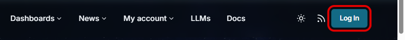{fig-alt="Top of the nrp.ai home page with the Log In button outlined in red." style="width:100%; display:block; margin:0 0 0.5em 0;"}

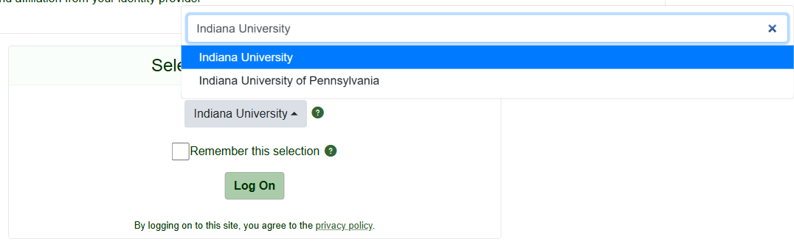{fig-alt="CILogon's identity provider list after typing Indiana University: Indiana University is highlighted; Indiana University of Pennsylvania is listed below it." style="width:100%; display:block;"}
:::
::::

::: {.source-line}
[@nrp_getting_started; @cilogon_idplist]
:::

## Joining the course namespace

1. While still logged in to NRP, open the **join link** from the instructor's email. It adds
   you to the course **namespace** (NRP's word for a project group), `<course namespace>`.
2. Check on [nrp.ai/namespaces](https://nrp.ai/namespaces): under **Mine** you see
   `<course namespace>`.

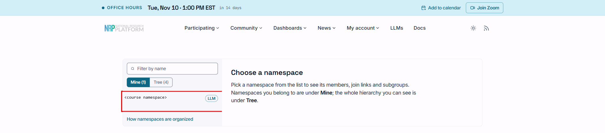{fig-alt="nrp.ai/namespaces with the Mine tab selected and the course namespace (name replaced by a placeholder) outlined in red." style="width:88%; display:block; margin:0.3em auto;"}

- The join link is for this class only: do not post or forward it. It admits only as many
  members as there are registered students.

::: {.source-line}
[@nrp_getting_started]
:::

## Creating your NRP key

:::: {.columns}
::: {.column width="42%"}
1. Open [nrp.ai/llmtoken](https://nrp.ai/llmtoken) (also **My account → LLM API keys**)
   and scroll to **Create new API key**.
2. **Alias:** any name, e.g. `course-hub`.
3. **Group:** choose `<course namespace>`. An empty list means you have not
   joined the namespace yet.
4. Click **Create new API key for general LLM API access**.
:::
::: {.column width="58%"}
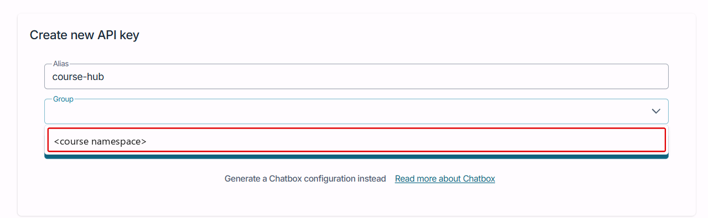{fig-alt="The Create new API key form with the Group list open and the course namespace (placeholder) outlined in red." style="width:100%; display:block; margin:0 0 0.5em 0;"}

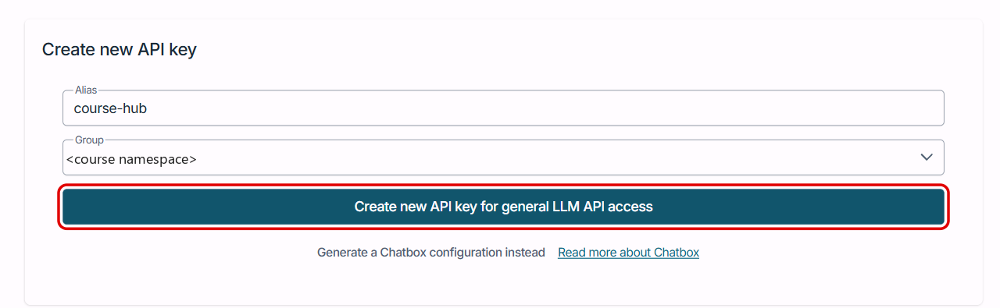{fig-alt="The form with Alias course-hub and Group set to the course namespace (placeholder), and the Create new API key button outlined in red." style="width:100%; display:block;"}
:::
::::

::: {.source-line}
[@nrp_llmtoken]
:::

## Copying the key before closing the box

:::: {.columns}
::: {.column width="52%"}
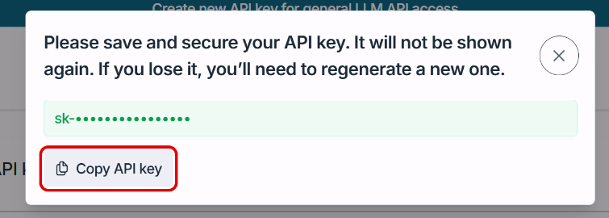{fig-alt="NRP's dialog: Please save and secure your API key. It will not be shown again. The key is hidden in this picture; the Copy API key button is outlined in red." style="width:100%; display:block;"}
:::
::: {.column width="48%"}
1. Click **Copy API key**.
2. Paste it into a password manager or a private note **before closing the box**.
:::
::::

- **NRP shows the key only once.** After the box closes it cannot be viewed or copied
  again; a lost key can only be deleted and replaced.
- The key is **yours**: every request made with it counts against your limits. Do not
  share it, and do not paste it into a chat, a notebook or a shared file.
- Limits per key: up to 8 requests at once for `qwen3-small`, 2 for `glm-5`, and 48,000
  output tokens per minute per model. Requests above that are refused with HTTP 429.
- The key is for course work only and expires when the course ends.

::: {.source-line}
[@nrp_llmtoken; @nrp_fair_use]
:::

## Signing in to the course hub

:::: {.columns}
::: {.column width="55%"}
1. Open **`<course hub address>`** from the instructor's email.
2. Enter the **username** and **password** from the email the instructor sends you.
3. The first time, the hub asks you to **choose your own password** (at least 10
   characters). Use that one from then on.
4. The first start takes up to a minute while your workspace is created.
:::
::: {.column width="45%"}
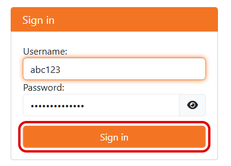{fig-alt="The course hub's Sign in box with a username and a hidden password filled in and the Sign in button outlined in red." style="width:100%; display:block;"}
:::
::::

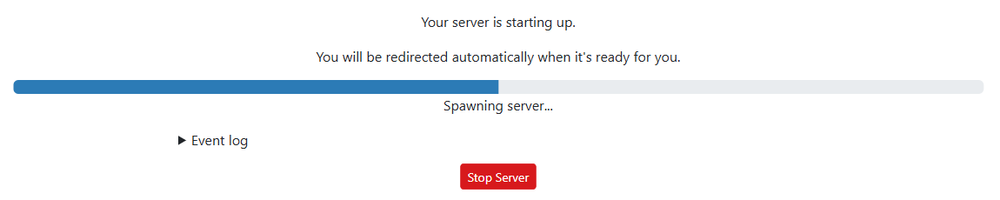{fig-alt="JupyterHub page: Your server is starting up, with a progress bar." style="width:56%; display:block; margin:0.3em auto 0;"}

::: {.source-line}
[@jupyterhub_docs]
:::

## Opening a terminal

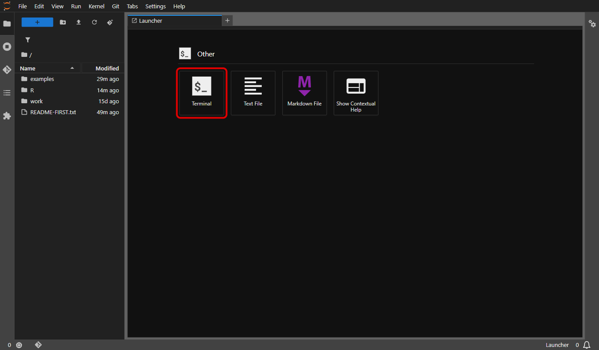{fig-alt="JupyterLab in the course hub: files on the left, and the Launcher on the right with Terminal outlined in red, next to Text File and Markdown File." style="height:520px; width:auto; max-width:100%; display:block; margin:0 auto;"}

- Your files are on the left; double-click `README-FIRST.txt` to read the workspace rules.
- In the **Launcher**, click **Terminal**. The **+** next to the tabs opens a new Launcher.
- To write your own code: a **Python 3** or **R** notebook, or **RStudio**, all from the same
  Launcher.

## Saving your key in the workspace

In the terminal, type:

```bash
set-nrp-key        # paste the key; nothing is shown as you type
```

Open a **new** terminal, then:

```bash
check-models       # lists the course models and whether each answers today
```

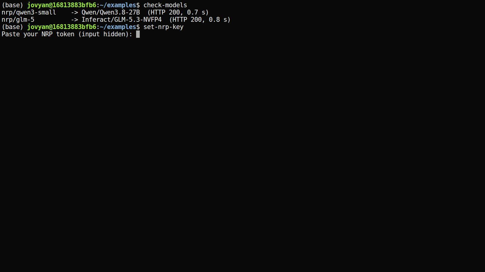{fig-alt="Terminal: set-nrp-key prompting for a key with hidden input, then check-models listing nrp/qwen3-small served by Qwen3.8-27B and nrp/glm-5 served by GLM-5.3, both responding." style="height:250px; width:auto; max-width:100%; display:block; margin:0.2em auto 0;"}

- The key is stored in `~/.nrp_key`, readable by you alone. Run `set-nrp-key` again to
  replace it.

## A first agent session

```bash
cd ~/examples
git init           # once per project: lets OpenCode find the project and undo changes
opencode           # or: pi
```

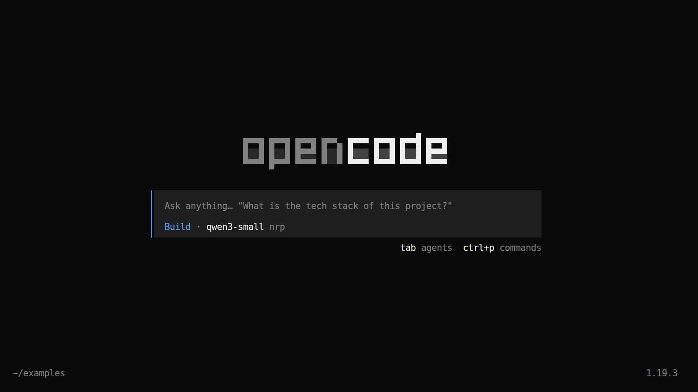{fig-alt="OpenCode's full-screen terminal interface just after starting in the examples folder: an empty conversation, a prompt box at the bottom, and the agent Build with the model nrp/qwen3-small shown." style="height:380px; width:auto; max-width:100%; display:block; margin:0.2em auto 0;"}

- Week 3 covers what to ask it and how to check the result. Today the goal is only
  that it answers.

::: {.source-line}
[@opencode_docs_cli]
:::

# 2 · Working in the hub

## Class materials with `get-week`

```bash
get-week               # lists the weeks available so far
get-week 4             # copies Week 4's files into ~/week-04
get-week 4 --refresh   # also updates files changed since your copy
```

- Each week's data, scripts and exercises arrive the same way, from Week 3 on.
- The copy is **yours** to edit. Running `get-week 4` again later adds files that are new
  since your last copy and **never overwrites** a file you have changed.
- When a file is corrected, `get-week 4 --refresh` replaces it and moves your old copy to
  `~/week-04-backup-<time>/`; files you created are left alone.

## Workspace limits

| | Limit | What happens at the limit |
|---|---|---|
| Memory | 3 GB | the process using the most memory is stopped; the workspace keeps running |
| CPU | 1 core | work runs slower |
| Processes | 512 | new processes cannot start |
| Your files (`~`) | 10 GB | writing fails until you delete something |
| Idle time | 60 minutes | the workspace stops; **your files are kept**, sign in to restart |

- Everything outside your home folder resets when the workspace restarts. Keep work
  in `~`.
- `pip install --user <package>` and R's `install.packages()` work. System-wide installs
  (`sudo`, `apt`, `conda`) do not.

## Websites, software and data

- From the workspace you can reach **any website** over HTTPS, and OpenCode can search the
  web. Other connections (SSH, email) are blocked.
- Already installed: Python (pandas, statsmodels, scikit-learn), R (tidyverse, lme4),
  Quarto, pandoc and git. Nothing to set up for the course exercises.
- **Synthetic or public data only.** No patient records, PHI or identifiable data.
  Neither NRP nor Jetstream2 is approved for it. Every prompt you send leaves the hub
  for NRP, and OpenCode's web searches go to [Exa](https://exa.ai/).
- The instructor can see every file in your workspace, including the ones you upload.
- The workspace is not a backup. Download anything you want to keep (right-click a file
  → Download) before the course ends.

::: {.source-line}
[@nrp_llm_managed; @jetstream2_docs]
:::

## Downloading your work

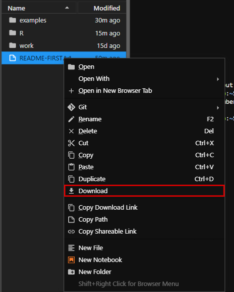{fig-alt="JupyterLab file list with the right-click menu open on README-FIRST.txt and Download outlined in red." style="height:540px; width:auto; max-width:100%; display:block; margin:0 auto;"}

- Right-click a file in the list on the left → **Download**. To upload, drag a file onto
  the list, or use the arrow-up button above it.
- Do this for anything you want to keep before the course ends.

# 3 · When something goes wrong

## Common problems

| What you see | Likely cause | What to do |
|---|---|---|
| "No NRP key yet" when a terminal opens | key not saved | `set-nrp-key`, then open a new terminal |
| Agent says 401 or "invalid key" | key mistyped or revoked | make a new key on nrp.ai, run `set-nrp-key` |
| `check-models` shows a model not responding | NRP is busy or in maintenance | try the other model; tell the instructor |
| Agent says 429 or slows down | your key's rate limit | wait a minute; fewer parallel tasks |
| Workspace does not start | first start, or the server is busy | wait one minute, then reload |
| `ssh` or `scp` times out | only web connections leave the hub | run it on your own computer |
| "Invalid username or password" | typo, or not on the class list yet | copy both from the email; else write to the instructor |

::: {.source-line}
[@nrp_fair_use]
:::

## Getting help

- Write to the instructor at `<instructor email>` with:
  - your network ID (or Purdue login),
  - what you ran, and the exact message (a screenshot is fine),
  - **never your NRP key**.
- Problems with your NRP account or key: [NRP support](https://nrp.ai/contact/).
