# Opening

## About these slides

- **This course and its slides are in development.** Content is subject to change from
  week to week, as the course runs and as the field moves.
- Every slide shows the date it was last updated, in its top-right corner.
- **Backup slides** at the end of each deck hold extra detail and evidence. They are for
  reference and are not covered in class.

## Overview

- This is a short course on using AI in research and analysis, with a focus on **essential concepts** and **practical application**.
  - From AI literacy to AI fluency
  - Key concepts 
  - AI Agents: Agents provided, hosted on NRP and Jetstream 2.
  - Safety and ethics
- Special thanks to Department of Biostatistics and Health Data Science, CCBB, Office of Data Science and Artificial Intelligence,especially, Dr. Marucs R Breese, at Indiana University, for supporting this course.
- We learn together
- Sign-up!!!!

## Core philosophy
- Use AI to help you use AI
- Learn from the Internet

## Using AI to learn AI

- **Ask AI on how to use AI**: "How do I use this tool for my research? What are the best practices?"
- **Ask AI to setup your AI workflow**
- You do not need to remeber every details in this course but focus on remebering the key concepts, you can then ask AI to do the detailed work.
- **Use another AI agent to fix the issue of an AI agent** 
- **Ask an AI agent what it can do for you**
- This slide is mainly built by multiple AI tools.

## Learning from the Internet

- There are tons of online resources you can learn, from frontier AI labs, to AI communities.
- There are many online implementation and workflows on Github, Huggingface, and other platforms. You can learn from them and adapt to your own research.
- Online community and social media can be good resources too as the field is developing so fast.
  - Reddit, X, Discord, Zhihu, WeChat, etc.
  - But many of them are not reliable, and are generated by AI, so you need to be careful and verify the information.

## The impact of AI

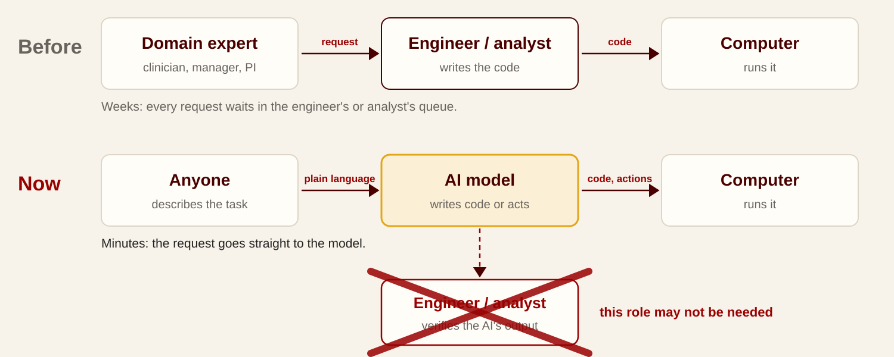{fig-alt="Two rows. Before: a domain expert such as a clinician, manager or PI sends a request to an engineer or analyst, who writes the code for the computer; weeks, because every request waits in a queue. Now: anyone describes the task in plain language to an AI model, which writes code or acts on the computer; minutes. A dashed arrow leads from the AI model to the engineer or analyst, who would verify the AI's output; that box is crossed out with a large red X, labeled: this role may not be needed." style="width:100%; height:500px; object-fit:contain; display:block; margin:0 auto;"}

- Search without query tricks; learning on demand; routine work automated.
- **But what is the cost?** 

## Course overview

| Week | Topic | What it covers |
|---|---|---|
| **1** · Oct 23 | AI foundations and appropriate data use | how language models work; tokens, cost and limits; when to use AI; classifying data before upload |
| **2** · Oct 30 | The harness: chatbots and agents that act | what a harness is; context, reasoning effort, web search; browser use, desktop agents, skills, MCP |
| **3** · Nov 6 | The harness in coding agents, hands-on | the course hub; instruction files and memory; asking for work and checking it; sandbox and record |
| **4** · Nov 13 | Data analysis and visualization | an analysis project step by step|
| **5** · Nov 20 | Literature, scientific writing and teaching | a literature scan; results to a paragraph; revising a Word manuscript; searching your own papers |
| **6** · Dec 4 | Safety, integrity and verification | funder and journal rules; data flows; enforced limits; verifiers |

: {tbl-colwidths="[17,30,53]"}

## A field faster than a course

:::: {.columns}
::: {.column width="58%"}
- Facts on these slides were checked in October 2026; some will already be wrong by the
  time you read them.
- Some content is kept for historical completeness: it explains why things are the way
  they are, even after the product is gone.
- An example of both: OpenAI's [Sora](https://openai.com/index/sora/) video app launched in September 2025, and was [shut
  down in April 2026](https://help.openai.com/en/articles/20001152-what-to-know-about-the-sora-app-discontinuation).
:::
::: {.column width="42%"}
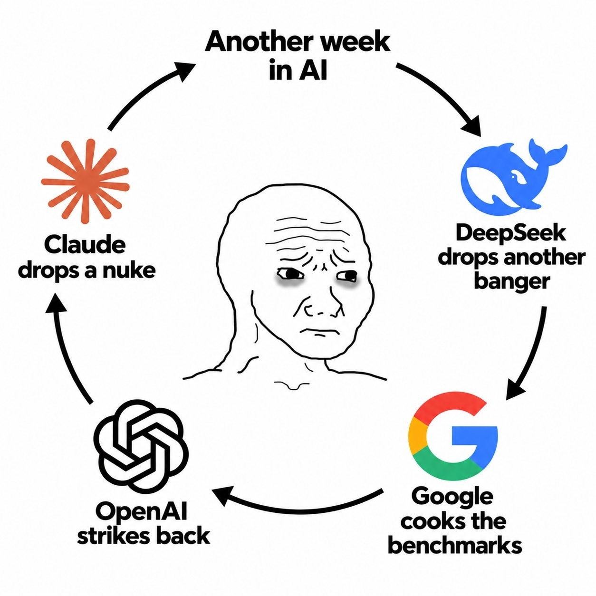{fig-alt="Meme: a tired Wojak face inside a loop of arrows. Another week in AI; DeepSeek drops another banger; Google cooks the benchmarks; OpenAI strikes back; Claude drops a nuke; and around again." style="width:100%; height:600px; object-fit:contain; display:block; margin:0 auto;"}
:::
::::

::: {.source-line}
[@openai2026soraend]
:::

## "Learn slowly enough, and you never have to learn it"

- A 2026 Chinese [essay](https://m.huxiu.com/article/4847185.html) went viral with the title **AI时代，只要你学得够慢，你就不用学了**:
  *"In the AI era, learn slowly enough and you'll never have to learn it."*
- Its argument:
  - prompt tricks that were sold as skills in 2023 went stale as models improved;
  - tool cycles shrank from years to weeks;
  - early adopters paid for every dead end, and late arrivals got mature tools for free.
- The half that is true: **tricks** expire.
- The half this session bets against: **concepts** do not expire. Tokens, sampling,
  training, context, cost, verification, and data rules explain every new tool as it
  arrives.

::: {.source-line}
[@wuka2026slow; @zhihu2026slow]
:::

## Seven levels of AI usage

:::: {.columns}
::: {.column width="36%"}
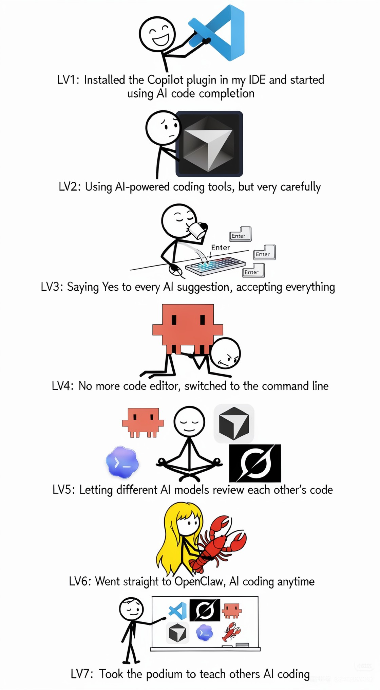{fig-alt="Stick-figure meme, LV1 to LV7: hugging the VS Code logo while installing Copilot; clutching an AI code editor cautiously; sipping coffee while pressing Enter on every suggestion; ridden by the Claude Code pixel mascot after switching to the command line; meditating among several coding-agent logos while models review each other's code; a blonde figure holding a red lobster, the OpenClaw icon; a man in a shirt and tie teaching AI coding at a whiteboard covered with all the logos." style="width:100%; height:700px; object-fit:contain; display:block; margin:0 auto;"}
:::
::: {.column width="64%"}
- **LV1:** installed the Copilot plugin; AI code completion.
- **LV2:** AI-powered coding tools, used very carefully.
- **LV3:** says "Yes" to every AI suggestion, accepts everything.
- **LV4:** drops the code editor for the command line.
- **LV5:** has different models review each other's code.
- **LV6:** goes straight to OpenClaw: AI coding anytime.
- **LV7:** takes the podium to teach others AI coding.
:::
::::

::: {.source-line}
Chinese meme, 2026, author unknown. Captions translated, and the LV7 figure redrawn, with FLUX 3 Image Klein.
:::

## Will Smith eating spaghetti: two years apart

:::: {.columns}
::: {.column width="50%"}
<video data-autoplay loop muted playsinline controls src="images/media/spaghetti-2023.mp4" style="width:100%; height:430px; object-fit:contain; display:block; background:#000;" aria-label="The 2023 ModelScope clip: a distorted, melting AI-generated face eating spaghetti."></video>

[March 2023: ModelScope text-to-video]{.caption}
:::
::: {.column width="50%"}
<video data-autoplay loop controls playsinline src="images/media/spaghetti-2025.mp4" style="width:100%; height:430px; object-fit:contain; display:block; background:#000;" aria-label="The 2025 Veo 3 clip: a near-photorealistic AI-generated man eating spaghetti, with sound."></video>

[May 2025: Google Veo 3, with generated sound]{.caption}
:::
::::

- The [clip](https://knowyourmeme.com/memes/ai-will-smith-eating-spaghetti) became an informal benchmark for AI video, rerun with every new model.
- What did not change: the model draws on statistics, not physics. [Veo 3](https://blog.google/technology/ai/generative-media-models-io-2025/)'s pasta
  *crunched*.

::: {.source-line}
[@kym_spaghetti; @commons_spaghetti2023; @commons_spaghetti2025]
:::

# 1 · A brief history of AI: from generative models to agents

<!-- ## A brief history of AI, told as it happened

- The story first; the explanations follow. Every era below introduces an idea this
  session explains later:
  - next-token prediction (Part 2)
  - tokens, cost, and context (Part 3)
  - pretraining, alignment, and reasoning (Part 4)
  - benchmarks and model choice (Part 5)
  - agents and harnesses (Week 2)
- We are living through this history; the last few slides are only months old. -->

## Seventy years on one line

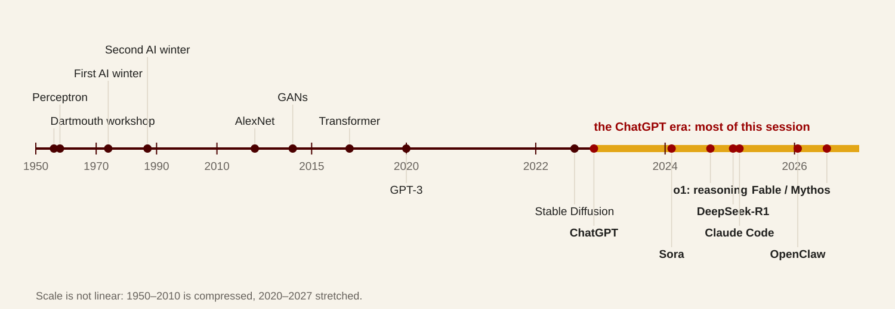{fig-alt="Timeline of AI from the 1956 Dartmouth workshop to Claude Fable and Mythos in 2026; the scale compresses 1950–2010 and stretches 2020–2027, where most events fall." style="width:100%; height:600px; object-fit:contain; display:block; margin:0 auto;"}

- The scale is not linear: almost everything in this session happened inside the gold
  band.

## The model race since ChatGPT

<video data-autoplay playsinline controls src="images/media/lab-race.mp4" style="width:100%; height:620px; object-fit:contain; display:block;" aria-label="Narrated 35-second bar chart race from November 2022 to September 2026: AI labs ranked by their best model so far on the Artificial Analysis Intelligence Index, coloured by country. GPT-3.5 alone at first; Claude 3 Opus, o1, Claude and o3, Grok 4 and GPT-5, Gemini 3 and GPT-5.2 trade the lead; Claude Opus 4.7 pulls clear; at the end Claude Opus 5.5 leads, GPT-6 Astra second, and five Chinese labs are in the top ten."></video>

- Same time per month throughout: the crowding in 2026 is the acceleration.

::: {.source-line}
Data: [@aa_data2026sep], best Intelligence Index score per lab by release date.
:::

## 2017: Attention is all you need

- Eight Google researchers publish the **[Transformer](https://arxiv.org/abs/1706.03762)**, an architecture built entirely on
  *attention* (Part 2).
- It processes all words of a text in parallel, so it scales on GPUs far better than
  earlier designs.
- Every model in this session (GPT, Claude, Gemini, DeepSeek, Qwen) is a descendant.
.

::: {.source-line}
[@vaswani2017attention]
:::

## Text to text: the GPT line, 2018–2020

| Model | Date | Size | What changed |
|---|---|--|--------|
| [GPT-1](https://cdn.openai.com/research-covers/language-unsupervised/language_understanding_paper.pdf) | June 2018 | 117M | "Generative pre-training" on books, then fine-tune |
| [GPT-2](https://openai.com/index/better-language-models/) | Feb 2019 | 1.5B | Released in stages; judged "too dangerous" to release at once |
| [GPT-3](https://arxiv.org/abs/2005.14165) | May 2020 | 175B | Does new tasks from a few examples in the prompt, with no retraining |

- OpenAI's bet was that the same simple objective, predicting the next word, gets more
  capable just by scaling up (Part 4, *scaling laws*).
- GPT-3 was stylistically fluent but factually unreliable, and it did not follow
  instructions well.

::: {.source-line}
[@radford2018gpt1; @openai2019gpt2; @brown2020gpt3]
:::

## November 30, 2022: ChatGPT

- OpenAI released [ChatGPT](https://openai.com/index/chatgpt/), built on GPT-3.5 and trained with human feedback to *follow
  instructions and converse* (Part 4, *post-training*).
- It reached about [100 million monthly users](https://www.reuters.com/technology/chatgpt-sets-record-fastest-growing-user-base-analyst-note-2023-02-01/) in about two months, then the fastest-growing
  consumer app on record.
- Text in, text out: one chat box for writing, coding, summarizing, and explaining.

::: {.source-line}
[@openai2022chatgpt; @reuters2023chatgpt]
:::

## Image to text: models that read images

- **March 2023:** [GPT-4](https://openai.com/index/gpt-4-research/) accepted images as input; [GPT-4V](https://cdn.openai.com/papers/GPTV_System_Card.pdf) opened it to users that
  September.
- **December 2023:** [Gemini 1.0](https://blog.google/technology/ai/google-gemini-ai/), trained on text, images, audio, and video from the start.
  **May 2024:** [GPT-4o](https://openai.com/index/hello-gpt-4o/), "omni": text, audio, and images in one model.
- Now standard: read a chart, a scanned form, a whiteboard photo, a microscopy image, or a
  screenshot of an error.
- Reading is not making: [Claude](https://platform.claude.com/docs/en/about-claude/models/overview) reads images but writes only text. Making images takes
  another kind of model (next).

::: {.source-line}
[@openai2023gpt4; @openai2024gpt4o; @google2023gemini; @anthropic_models]
:::

## Text to image and image to image, 2021–2026

| When | Type | Models | What changed |
|--|--|------|-----|
| 2021–2022 | Text → image | [DALL·E](https://openai.com/index/dall-e/), [Midjourney](https://www.midjourney.com), **[Stable Diffusion](https://arxiv.org/abs/2112.10752)** (open weights) | *Diffusion*: start from noise, remove it step by step, guided by the prompt |
| 2024 | Text → image | [FLUX.1](https://github.com/black-forest-labs/flux) (Black Forest Labs) | Open-weight quality catches up with closed models |
| 2025 | Image → image | [GPT-4o images](https://openai.com/index/introducing-4o-image-generation/), **[Nano Banana](https://developers.googleblog.com/en/introducing-gemini-2-5-flash-image/)**, [FLUX.1 Kontext](https://bfl.ai/announcements/flux-1-kontext) | Edit a picture with words: "fix one detail, keep the rest" |
| 2025–2026 | Both | [Qwen-Image](https://arxiv.org/abs/2508.02324), [Z-Image](https://huggingface.co/Tongyi-MAI/Z-Image-Turbo), [Ideogram 4.0](https://huggingface.co/ideogram-ai/ideogram-4-nf4), [Krea 2](https://huggingface.co/krea/krea-2-turbo), [FLUX.2](https://bfl.ai/blog/flux-2) (open) | Readable text in images; small models run on one GPU |
| Oct 2026 | Both | Open: **[FLUX 3 Image Klein](https://bfl.ai/blog/flux-3-image-klein)**, [MOSS-Image](https://openmoss.ai/MOSS-Image/). [Arena](https://artificialanalysis.ai/text-to-image/arena/leaderboard-text) leaders: GPT Image 2.5, Nano Banana 2.1 | Layouts set in a JSON prompt; ranked by blind human votes |

- Text inside generated images was gibberish until 2024. Now posters and figure labels
  work, and so do fake "data" figures.
- "Open weights" is not "free to use": Ideogram 4.0 and [Qwen-Image-2.1](https://huggingface.co/Qwen/Qwen-Image-2.1) are non-commercial.

::: {.source-line}
[@openai2021dalle; @rombach2022sd; @openai_4o_image; @google_nbpro; @bfl2025kontext; @zimage_turbo; @ideogram4_hf; @krea2_hf; @bfl_flux3klein; @mossimage2026; @aa_t2i]
:::

## Image generation, in practice

:::: {.columns}
::: {.column width="66%"}
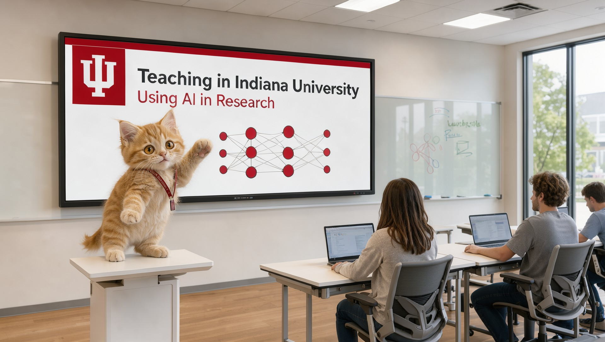{fig-alt="AI-generated photo of a fluffy ginger kitten standing on a white lectern in a modern classroom, pointing at a wall screen whose slide shows the crimson IU trident tab, the title Teaching in Indiana University, the subtitle Using AI in Research, and a neural-network diagram; students with laptops sit at white tables by a glass wall." style="width:100%; height:600px; object-fit:contain; display:block; margin:0 auto;"}
:::
::: {.column width="34%"}
- Made by the instructor on a local workstation GPU with [FLUX 3 Image Klein](https://huggingface.co/black-forest-labs/flux-3-image-klein-comfy) (distilled, 4-bit) in [ComfyUI](https://github.com/comfyanonymous/ComfyUI): 16 steps, about 15 seconds at 1920×1088.
- **Image to image:** the real IU trident, cropped from the FSPH syllabus template, went in as a reference image; the model placed it on the slide.
- The model rendered the slide text itself and spelled it right in four of four tries.
- Decoration, not data: the room, the students, and the kitten are invented.
:::
::::

## Six fingers, and the rat that passed peer review

:::: {.columns}
::: {.column width="42%"}
- Early image models drew extra fingers: they learn pixel statistics, not anatomy.
- **February 2024:** [a review article](https://doi.org/10.3389/fcell.2024.1386861) in *Frontiers in Cell and Developmental Biology*
  included Midjourney-made figures: a rat with impossible anatomy, and labels in invented
  words ("dissilced", "testtomcels").
- It had passed peer review and been published. Readers spotted it on social media within
  days; the journal retracted it three days after publication.
- A generated image may not reflect research contents. In a paper or poster it can count as  fabrication, like altering raw results.
- For diagrams, ask AI for editable SVG or plotting code instead (Week 4-5).
:::
::: {.column width="20%"}
{fig-alt="An AI-generated hand with six fingers, made with Stable Diffusion 1.5." style="width:100%; height:380px; object-fit:contain; display:block; margin:0 auto;"}
:::
::: {.column width="38%"}
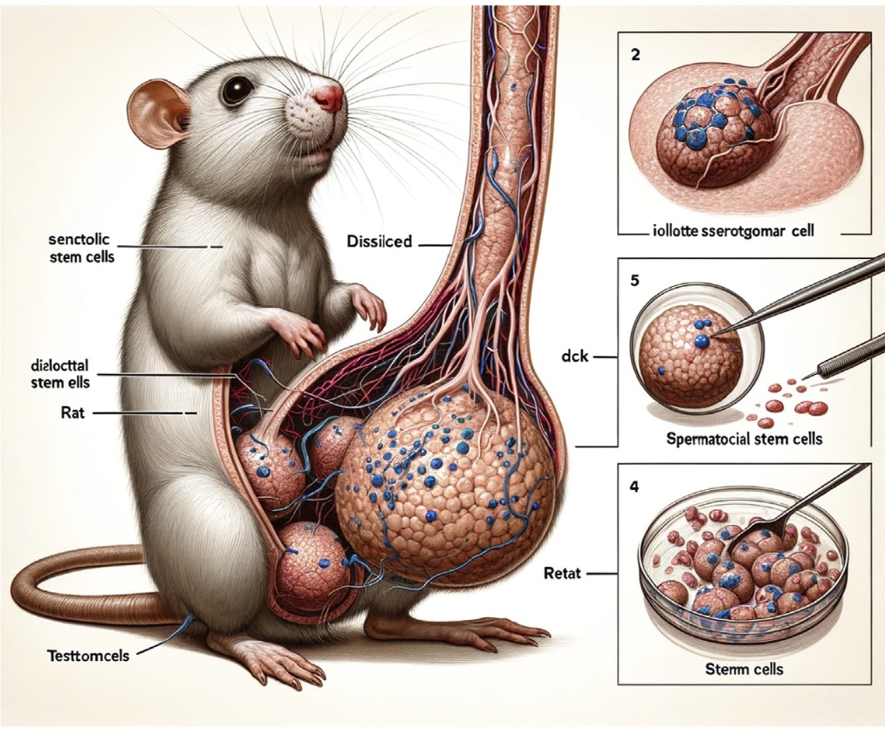{fig-alt="The retracted Frontiers figure: a rat with grossly oversized anatomy and nonsense labels such as dissilced, testtomcels, and iollotte sserotgomar cell." style="width:100%; height:560px; object-fit:contain; display:block; margin:0 auto;"}
:::
::::

 

::: {.source-line}
[@frontiers2024retraction; @commons_aihand]
:::

## Text to video and reference to video, 2024–2026

- **Text to video:** OpenAI's [Sora preview](https://openai.com/index/sora/) (Feb 2024); Google's **[Veo 3](https://blog.google/technology/ai/generative-media-models-io-2025/)** adds synchronized
  sound (May 2025); OpenAI shut Sora down in 2026.
- **Reference to video:** start from a still or from reference images, and keep the same
  character, product, or style across shots. Kuaishou's **[Kling 4.0](https://www.globenewswire.com/news-release/2026/10/16/3382768/0/en/kling-ai-officially-launches-next-generation-kling-4-0-raising-the-bar-for-professional-grade-video-models.html)** (Oct 15, 2026) takes up to
  15 reference images.
- **Chinese labs now lead** the [Artificial Analysis ranking](https://artificialanalysis.ai/video/leaderboard/text-to-video) (Oct 15, 2026): 8 of the top 12.

| Rank | Model | Lab |
|-|----|----|
| 1 | [Wan 3.0](https://huggingface.co/Wan-AI) | Alibaba |
| 2 | [MiniMax H3](https://hailuoai.video) | MiniMax |
| 4 | [Seedance 2.5](https://seed.bytedance.com) | ByteDance |
| 5 | [FLUX 3](https://bfl.ai) | Black Forest Labs (Germany) |
| 7 | Gemini Omni Flash 1.1 | Google |

::: {.source-line}
[@openai2024sora; @google_gemini_changelog; @openai_deprecations; @aa_video; @kling4_2026]
:::

## Audio, and video in practice

:::: {.columns}
::: {.column width="55%"}
<video data-autoplay controls playsinline src="images/media/cat-teaching-iu-h3.mp4" style="width:100%; height:520px; object-fit:contain; display:block; background:#000;" aria-label="AI-generated video with sound: the kitten at the lectern asks Any questions?; a student raises a hand and asks Professor, are you a real cat?; the kitten grins, Real enough to grade your homework, then dissolves into gold pixels that fly into a student laptop, leaving its red lanyard on the lectern."></video>

[Made by the instructor: MiniMax H3, image to video with native audio, from the kitten image; 8 steps on a local GPU.]{.caption}
:::
::: {.column width="45%"}
- **Music:** [Suno](https://suno.com), [Udio](https://www.udio.com), Google [Lyria 3](https://9to5google.com/2026/02/18/gemini-app-music-lyria-3/): full songs with vocals from a
  prompt.
- **Text to speech:** [ElevenLabs](https://elevenlabs.io), Gemini TTS: [close to a human reader](https://artificialanalysis.ai/text-to-speech/arena).
- **Speech to text:** OpenAI's [Whisper](https://arxiv.org/abs/2212.04356) (2022, open weights) made accurate
  transcription free; it is now built into most apps.
:::
::::

::: {.source-line}
[@riaa2024suno; @google2026lyria3; @aa_tts; @radford2022whisper]
:::

## September 2024: models that think before answering

- OpenAI's **[o1](https://openai.com/index/learning-to-reason-with-llms/)** was trained to write a long chain of thought before it answers. Code
  name: *Strawberry*.
- More thinking time gave better answers in maths and code: a second way to scale, beside
  model size.
- OpenAI hid the thinking, showing only a summary, and kept the training method secret.
  How it works: Part 4.

::: {.source-line}
[@openai2024o1]
:::

## January 2025: the DeepSeek moment

:::: {.columns}
::: {.column width="62%"}
- **January 20, 2025:** the Chinese lab DeepSeek released **[DeepSeek-R1](https://github.com/deepseek-ai/DeepSeek-R1)**, a reasoning
  model that matched o1 on maths and coding, and gave it away:
  - open weights under the MIT license;
  - the full training recipe, first model [peer-reviewed in *Nature*](https://www.nature.com/articles/s41586-025-09422-z);
  - Reasoning can be achieved by reinforcement learning, nothing magic.
  - **the full chain of thought, visible**.
- Cheap by design, and published: [mixture-of-experts](https://arxiv.org/abs/2412.19437), smaller memory caches, FP8
  training. V3's final training run cost about US$5.6 million.
- January 27: [Nvidia lost a record US$593 billion](https://www.business-standard.com/markets/news/deepseek-sparks-ai-stock-selloff-nvidia-loses-record-593-bn-in-mcap-125012800095_1.html) in one day. "AI's Sputnik moment."
- One flaw, for Part 8: R1 hallucinated far more than its own base model (14.3% vs. 3.9%
  on [Vectara's test](https://vectara.com/blog/deepseek-r1-hallucinates-more-than-deepseek-v3)).
:::
::: {.column width="38%"}
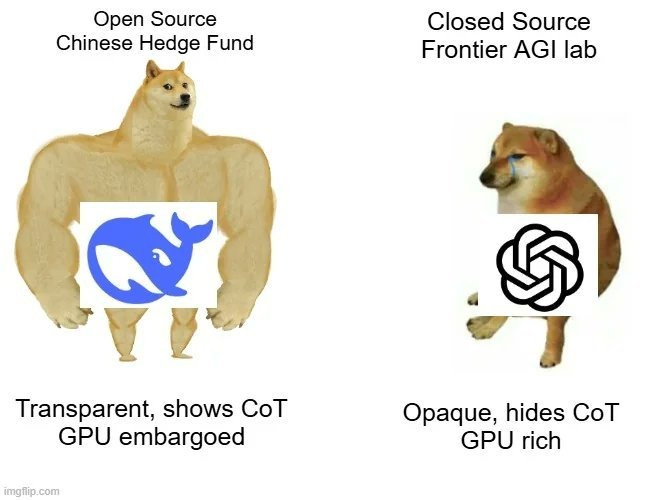{fig-alt="Buff Doge versus Cheems meme. Left, a muscular Doge with the DeepSeek whale: Open Source Chinese Hedge Fund; transparent, shows CoT; GPU embargoed. Right, a small crying Cheems with the OpenAI logo: Closed Source Frontier AGI lab; opaque, hides CoT; GPU rich." style="width:100%; height:460px; object-fit:contain; display:block; margin:0 auto;"}
:::
::::

::: {.source-line}
[@deepseek2025r1; @deepseek2024v3; @bs2025nvidia; @stheadline2025guoyun; @vectara2025r1hallucinates; @dailydot2025deepseekmemes]
:::

## Open-weight models: the rise and the debate

:::: {.columns}
::: {.column width="64%"}
- **2023:** a [leaked Google memo](https://newsletter.semianalysis.com/p/google-we-have-no-moat-and-neither): "we have no moat, and neither does OpenAI". Then
  [LLaMA](https://ai.meta.com/blog/large-language-model-llama-meta-ai/), [Mixtral](https://mistral.ai/news/mixtral-of-experts), [Qwen](https://github.com/QwenLM), DeepSeek, [Kimi](https://moonshotai.github.io/Kimi-K2/), and OpenAI's own [gpt-oss](https://openai.com/index/introducing-gpt-oss/) (2025).
- **2026:** open models trail the frontier by months, not years (ok, typical AI slop). Most of the best come from Chinese labs.
- **Open weights is not open source.** [Open source](https://opensource.org/ai/open-source-ai-definition) also needs the training code
  and data information. Fully open: [OLMo](https://allenai.org/olmo), [Pythia](https://github.com/EleutherAI/pythia).
- **For:** run privately, study, reproduce. [Altman](https://techcrunch.com/2025/01/31/sam-altman-believes-openai-has-been-on-the-wrong-side-of-history-concerning-open-source): OpenAI had been "on the wrong side of history".
  - National Research Platform (NRP), and IU REALLMS host open models for research.
- **Against:** "a red herring" (Amodei); open labs [distilling closed models](https://www.anthropic.com/news/detecting-and-preventing-distillation-attacks).
:::
::: {.column width="36%"}
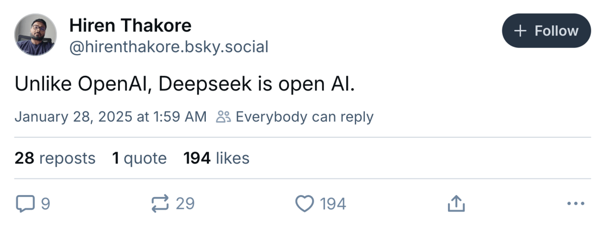{fig-alt="Bluesky post by Hiren Thakore, January 28, 2025: Unlike OpenAI, Deepseek is open AI." style="width:100%; height:220px; object-fit:contain; display:block; margin:0 auto;"}
:::
::::

::: {.source-line}
[@semianalysis2023moat; @meta2023llama; @mistral2023mixtral; @openai2025gptoss; @osi2024osaid; @techcrunch2025altman; @kantrowitz2025amodei; @anthropic2026distillation; @dailydot2025deepseekmemes]
:::

## 2024–2026: from chatbots to agents, and the harness

- An **agent** works toward a goal in a loop: it plans, calls tools, checks the result,
  and repeats (Week 2).

:::: {.columns}
::: {.column width="58%"}
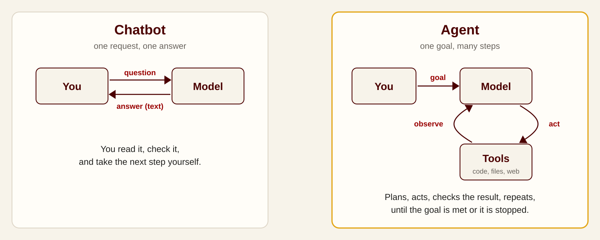{fig-alt="Left: a chatbot; you ask a question and the model returns an answer as text, and you take the next step. Right: an agent; you give a goal, and the model loops through acting with tools and observing results until the goal is met." style="width:100%; height:400px; object-fit:contain; display:block; margin:0 auto;"}
:::
::: {.column width="42%"}
| When | Milestone |
|--|-----|
| Nov 2024 | [MCP](https://modelcontextprotocol.io): a standard plug between models and tools |
| Feb 2025 | [Claude Code](https://www.anthropic.com/claude-code); Karpathy's **"vibe coding"** |
| Apr 2025 | [OpenAI Codex](https://github.com/openai/codex) |
| Late 2025 | **["Harness"](https://langchain.com/blog/the-anatomy-of-an-agent-harness)**: everything around the model |
| Jan 2026 | [OpenClaw](https://github.com/openclaw/openclaw) goes viral; [Claude Cowork](https://claude.com/product/cowork) |
| Aug–Sep 2026 | Always-on agents: [SpaceXAI *Grok Bot*](https://venturebeat.com/orchestration/spacexais-grok-bot-turns-agents-into-persistent-digital-coworkers-that-can-operate-your-apps-for-120-per-month), [OpenAI *dots*](https://openai.com/index/introducing-dots/), [Meta *Muse*](https://axios.com/2026/09/08/meta-debuts-muse-personal-ai-agent) |
:::
::::

::: {.source-line}
[@anthropic2024mcp; @anthropic2025claudecode; @collins2025vibe; @openclaw; @venturebeat2026grokbot; @openai2026dots]
:::

## The LLM race (October 2026) {.dense}

| Lab | | Newest models | Weights |
|-----|-|------|---|
| {height="22px"} OpenAI | {height="18px" fig-alt="US flag"} | [GPT-6 Astra, GPT-6.1 Sol, GPT-6 Luna](https://developers.openai.com/api/docs/models); gpt-oss | Closed; gpt-oss open |
| {height="22px"} Anthropic | {height="18px" fig-alt="US flag"} | [Claude Opus / Sonnet / Haiku 5.5](https://platform.claude.com/docs/en/about-claude/models/overview); [Fable 5.1](https://www.anthropic.com/claude-fable-and-mythos-5-1); Mythos 5.1 (restricted) | Closed |
| {height="22px"} Google DeepMind | {height="18px" fig-alt="US flag"}{height="18px" fig-alt="GB flag"} | [Gemini 4 Argon](https://blog.google/innovation-and-ai/products/gemini-app/gemini-4-availability) (Oct 13), Gemini 3.8 Flash; [Gemma 4](https://ai.google.dev/gemma) | Closed; Gemma open |
| {height="22px"} [SpaceXAI](https://www.engadget.com/2209300/xai-now-officially-spacexai/) | {height="18px" fig-alt="US flag"} | Grok 4.7 | Closed |
| {height="22px"} Meta | {height="18px" fig-alt="US flag"} | [Muse Wonder](https://techcrunch.com/2026/10/12/meta-releases-its-first-frontier-model-muse-wonder) (Oct 12); Muse Spark Open (Oct 15) | Closed; Spark Open open |
| {height="22px"} Mistral | {height="18px" fig-alt="FR flag"} | [Mistral Large 4](https://mistral.ai) (preview), Medium 3.5 | Open (Large 4 weights due late Oct) |
| {height="22px"} DeepSeek | {height="18px" fig-alt="CN flag"} | V4.1 Flash; [update 1017](https://huggingface.co/deepseek-ai/DeepSeek-V4.1-Flash-1017) (Oct 17) | Open |
| {height="22px"} Alibaba | {height="18px" fig-alt="CN flag"} | [Qwen3.8](https://github.com/QwenLM), Qwen3.8-Max | Open |
| {height="22px"} Moonshot AI | {height="18px" fig-alt="CN flag"} | [Kimi K3](https://huggingface.co/moonshotai) | Open |
| {height="22px"} Z.ai (Zhipu) | {height="18px" fig-alt="CN flag"} | [GLM-5.3](https://huggingface.co/zai-org) | Open |
| {height="22px"} ByteDance | {height="18px" fig-alt="CN flag"} | [Doubao-Seed 2.0](https://technode.com/2026/02/14/bytedance-releases-doubao-seed-2-0/) | Closed |
| {height="22px"} MiniMax · Xiaomi | {height="18px" fig-alt="CN flag"} | [MiniMax-M3](https://huggingface.co/MiniMaxAI); [MiMo-V2.6-Pro](https://huggingface.co/XiaomiMiMo) (Sep 22) | Open |

- Top of the Intelligence Index: Claude Opus 5.5 (58). Best open-weight model: MiMo-V2.6-Pro (46).

::: {.source-line}
[@aa_models; @openai_models; @anthropic_models; @google2026gemini4; @techcrunch2026musewonder; @engadget2026spacexai; @technode2026doubao; @deepseek_v41flash1017]
:::

## The frontier of state-of-the-art AI

- **Too capable to release?** Anthropic held back *Claude Mythos* (April 2026) for its
  hacking ability. Since September the same model ships twice: [Fable 5.1](https://www.anthropic.com/claude-fable-and-mythos-5-1) for everyone,
  Mythos 5.1, with fewer safeguards, for vetted security and life-science programs.
- **Mathematics:**

| When | Result |
|--|--------|
| Jul 2025 | OpenAI and Google DeepMind models reach [gold-medal level](https://deepmind.google/discover/blog/advanced-version-of-gemini-with-deep-think-officially-achieves-gold-medal-standard-at-the-international-mathematical-olympiad/) at the Mathematical Olympiad |
| Oct 2025 | GPT-5 "solved" [10 Erdős problems](https://techcrunch.com/2025/10/19/openais-embarrassing-math/); it had found existing solutions ("embarrassing") |
| Feb 2026 | Donald Knuth, [*Claude's Cycles*](https://www-cs-faculty.stanford.edu/~knuth/papers/claude-cycles.pdf): "Shock! Shock!" Claude solved a problem he was working on |
| Oct 2026 | DeepMind's [AlphaProof Nexus](https://www.science.org/doi/10.1126/science.aej2213): Lean-verified proofs for 9 of 353 open Erdős problems |

- A result counts only after it is checked, by a proof assistant or by experts.

::: {.source-line}
[@anthropic2026fable51; @deepmind2025imo; @techcrunch2025erdos; @knuth2026cycles; @deepmind2026alphaproofnexus]
:::

## Watching the race

<video data-autoplay muted playsinline controls src="images/media/compute-race.mp4" style="width:100%; height:660px; object-fit:contain; display:block;" aria-label="Animation of training compute for every notable AI model since 2012, by publication date and country: US, China, other. A gold line traces the largest training run so far, rising from about 10 to the 17 FLOP to about 10 to the 27 FLOP with GPT-6 Astra in 2026."></video>

::: {.source-line}
Data: [@epoch_models], notable models with a training-compute estimate. Live trackers: [epoch.ai](https://epoch.ai/data/ai-models), [lmarena.ai](https://lmarena.ai), [artificialanalysis.ai](https://artificialanalysis.ai).
:::

# 2 · Language models: the basics

## Generative pre-trained models

- A **discriminative model** sorts inputs into labels: *is this X-ray normal or abnormal?*
- A **generative model** learns what the data look like, so it can produce new examples:
  text, images, audio, protein sequences.
- **GPT** spells it out: **G**enerative **P**re-trained **T**ransformer.
  - *Generative:* every answer is a **sample** drawn from probabilities, not a lookup. So
    it is plausible by construction, not true by construction, and the same request can
    produce different outputs.
  - *Pre-trained:* the learning happened **before** you arrived (Part 4). The model is then
    frozen.
- An early myth: "the more you talk to it, the smarter it gets." It does not. Your chat
  changes the **context**, not the model.
  - "Memory" and agent features save notes and put them back into the context, so it
    *feels* like learning. Delete the notes, and it is gone.

::: {.source-line}
[@radford2018gpt1; @brown2020gpt3]
:::

## Next-token prediction

- A language model answers one question, over and over: *given the text so far, what comes
  next?*
- Formally, it computes P(next token | all previous tokens) over its whole vocabulary.
- A long answer is this step repeated: pick a token, append it, predict again.
- A **large** language model (LLM) does this with billions of learned parameters, trained
  on trillions of tokens.

::: {.source-line}
[@zhang2026]
:::

## Sampling: why the same prompt gives different answers

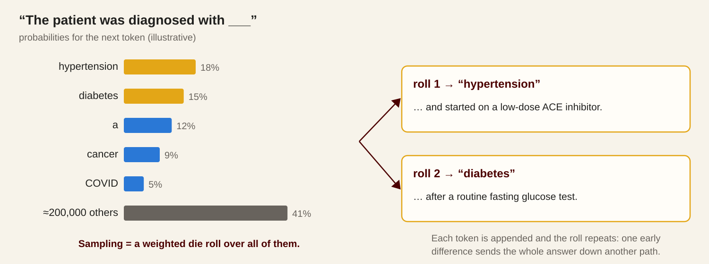{fig-alt="The patient was diagnosed with: probabilities hypertension 18 percent, diabetes 15, a 12, cancer 9, COVID 5, about 200,000 others 41. Roll 1 picks hypertension and continues: and started on a low-dose ACE inhibitor. Roll 2 picks diabetes and continues: after a routine fasting glucose test." style="width:100%; height:430px; object-fit:contain; display:block; margin:0 auto;"}

- Output is generated randomly.
- One good answer is an anecdote. Run important prompts more than once, and record the
  model, version, date, and settings.

::: {.source-line}
[@hf_howtogenerate; @he2025nondeterminism]
:::

## Same prompt, two seeds

- [Gemma 4 12B](https://huggingface.co/google/gemma-4-12B-it), an open-weight model, on the instructor's GPU, temperature 1.0:
  *"In two sentences, explain to a new graduate student what a p-value is."*

:::: {.columns}
::: {.column width="50%"}
**Seed 1**

> A p-value is the probability of obtaining test results at least as extreme as the ones
> observed, assuming that the null hypothesis [(the default assumption of "no effect")]{style="background:#fbe6b3;"} is
> actually true. [It helps you determine if your data provides sufficient evidence to
> reject that null hypothesis, with a lower p-value indicating stronger evidence against
> it.]{style="background:#fbe6b3;"}
:::
::: {.column width="50%"}
**Seed 2**

> A p-value is the probability of obtaining test results at least as extreme as the ones
> observed, assuming that the null hypothesis [(the idea that there is no effect or
> difference)]{style="background:#fbe6b3;"} is actually true. [In practice, it helps you determine if your data
> provides sufficient evidence to reject that null hypothesis in favor of an alternative
> explanation.]{style="background:#fbe6b3;"}
:::
::::

- Seed 1 again: word for word the same. Temperature 0, run twice: identical. The seed fixes
  the dice; chat apps do not let you set it.


## Tokens: the units a model reads

- A model does not read letters or words; it reads **tokens**: words, word fragments,
  punctuation, whitespace, or parts of numbers.
- Real output of [GPT-4o's tokenizer](https://platform.openai.com/tokenizer): each colored band is one token.

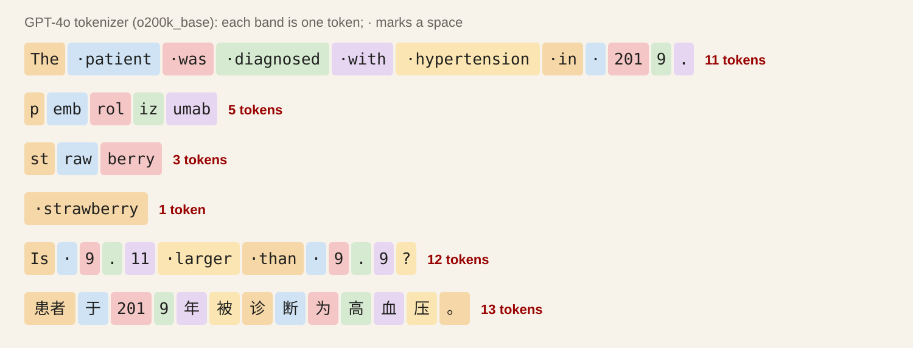{fig-alt="GPT-4o tokenizer output: the English sentence is 11 tokens; pembrolizumab is 5 pieces; strawberry is st, raw, berry but one token with a leading space; 9.11 and 9.9 split at the decimal point; the 16-character Chinese sentence is 13 tokens." style="width:100%; height:440px; object-fit:contain; display:block; margin:0 auto;"}

- Common words get one token; rare drug names, numbers, and leading spaces change the
  split.

::: {.source-line}
[@openai_tokenizer; @tiktokenizer]
:::

## Tokenization varies by model and language

- The same Chinese sentence, 患者于2019年被诊断为高血压。 (16 characters):
  - GPT-4's tokenizer (`cl100k_base`): **20 tokens**, several of them partial bytes of a
    character;
  - GPT-4o's tokenizer (`o200k_base`): **13 tokens** (`患者` `于` `201` `9` `年` …).
- [DeepSeek's rule of thumb](https://api-docs.deepseek.com/quick_start/token_usage): one Chinese character ≈ 0.6 token; one English character ≈ 0.3
  token.
- Across languages, the same content can cost [up to 15× more tokens](https://arxiv.org/abs/2305.15425). That means higher
  cost, slower output, and less fitting in the context window.
- English rule of thumb: 1 token ≈ 4 characters ≈ ¾ of a word, but newer tokenizers
  differ. [Claude's current tokenizer](https://platform.claude.com/docs/en/about-claude/models/overview) fits about 555,000 words in 1 million tokens.

- Each token then becomes an **embedding**, a vector of numbers in which similar meanings
  sit close: *hypertension* near *high blood pressure*, far from *tangerine*.

::: {.source-line}
[@deepseek_tokens; @petrov2023tokenizers; @openai_tokens; @anthropic_models; @mikolov2013; @openai_embeddings]
:::

## Images, audio, and video become tokens too

- Images are cut into patches, and each patch becomes a token.
  - [Claude](https://platform.claude.com/docs/en/build-with-claude/vision): ⌈width/28⌉ × ⌈height/28⌉ tokens, so a 1000×1000-pixel image costs 1,296 tokens.
  - [Gemini](https://ai.google.dev/gemini-api/docs/tokens): 258 tokens per 768×768 tile; audio costs 32 tokens per second.
- A screenshot can cost as much as a page of text, and it is processed under the same
  rules, including data rules (Part 9).

::: {.source-line}
[@anthropic_vision; @google_tokens]
:::

## Images as grids of tokens

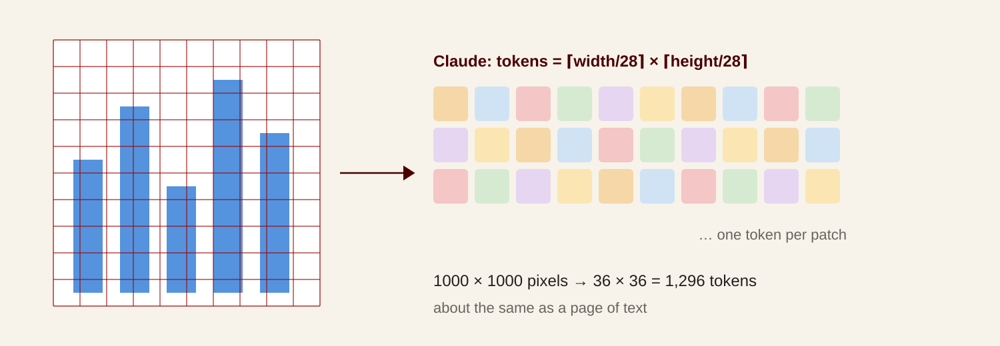{fig-alt="A bar-chart image overlaid with a grid; each grid cell becomes one token. A 1000 by 1000 pixel image is 36 by 36 patches, 1,296 tokens." style="width:100%; height:560px; object-fit:contain; display:block; margin:0 auto;"}

::: {.source-line}
[@anthropic_vision]
:::


## Attention and the context window

- **Attention** lets each token weigh every other token in the current context when the
  next one is computed.
- The **context window** is the finite capacity shared by:
  - system instructions
  - conversation
  - supplied material
  - retrieved passages
  - tool results
  - the response
- Ordering and irrelevant material affect output. An important requirement can be present
  yet receive too little attention to influence the response; this includes safety
  requirements.
- Critical requirements should be concise and prominent, but attention is not an
  enforceable safety control (Week 6).
- Long work therefore requires selection, retrieval, summarization, or compression. (This is why we need AI agent or harness for large scale projects.)

::: {.source-line}
[@vaswani2017attention; @liu2024lost]
:::

# 3 · Tokens in, tokens out: cost, speed, limits

## Everything as tokens

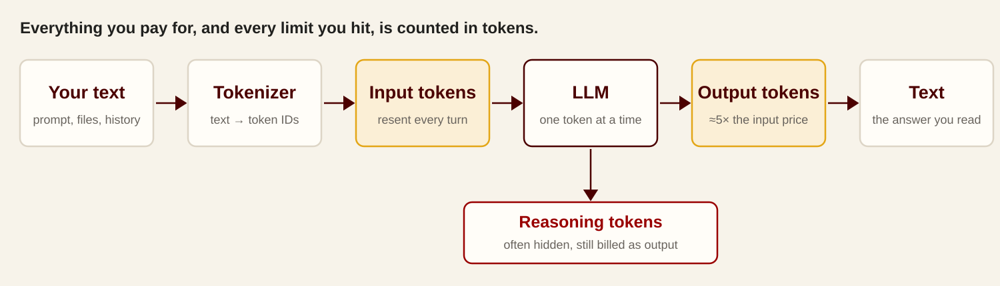{fig-alt="Flow diagram: your text goes to the tokenizer, becomes input tokens (resent every turn), goes into the LLM, which writes output tokens (about five times the input price) that become the text you read; a branch from the LLM shows reasoning tokens, often hidden but still billed as output." style="width:100%; height:560px; object-fit:contain; display:block; margin:0 auto;"}

## Token costs: one task, four models

Task: summarize a 25,000-word paper. About 40k input tokens, 1k output tokens, and 10k
reasoning tokens.

| Model (API, October 2026) | Input $/M tokens | Output $/M tokens | This task |
|---|---|---|---|
| [DeepSeek V4.1-Flash](https://api-docs.deepseek.com/quick_start/pricing) (off-peak) | 0.15 | 0.60 | ≈ $0.013 |
| [Claude Sonnet 5.5](https://platform.claude.com/docs/en/about-claude/pricing) | 2 | 10 | ≈ $0.19 |
| [Gemini 4 Argon](https://ai.google.dev/gemini-api/docs/pricing) | 2 | 10 | ≈ $0.19 |
| [GPT-6 Astra](https://developers.openai.com/api/docs/pricing) | 10 | 50 | ≈ $0.95 |

- A 70× spread for the same summary. Prices change often.
- In a chat, the whole history is resent every turn. **[Prompt caching](https://platform.claude.com/docs/en/build-with-claude/prompt-caching)** discounts the
  repeated part by 90–95%.
- Subscriptions hide these costs behind usage limits; the limits come from the same
  arithmetic.

::: {.source-line}
[@anthropic_pricing; @openai_pricing; @google_pricing; @deepseek_pricing]
:::

## Context window and output limits

| Model | Context window | Max output |
|---|---|---|
| Claude Opus / Sonnet / Haiku 5.5, Fable 5.1 | 1M | 128K |
| GPT-6.1 Sol, GPT-6 Luna | 1.05M | 128K |
| [Gemini 4 Argon](https://ai.google.dev/gemini-api/docs/models/gemini-4-argon) | 1,048,576, shared by input **and** output | 65,536 by default |
| [DeepSeek V4](https://api-docs.deepseek.com/quick_start/pricing) | 1M | 384K |
| [Qwen3.8-Flash-Next](https://huggingface.co/Qwen/Qwen3.8-Flash-Next) (open weights) | 262K native | 131K recommended |
| [Llama 4 Scout](https://huggingface.co/meta-llama/Llama-4-Scout-17B-16E-Instruct) (open weights) | 10M | — |

- Input and output limits differ: output is typically 8–15× smaller.
- 1 million tokens is about 1,500 pages, but a large window is not equal attention to
  every page ([*context rot*](https://research.trychroma.com/context-rot)).

::: {.source-line}
[@anthropic_models; @openai_models; @google_argon; @deepseek_pricing; @qwen38; @llama4]
:::

## Cost, latency, and model size

- Cost and latency scale with token use: input, output, and reasoning.
- Use the smallest capable model, and limit context to material relevant to the task.
- Output speed is typically reported in tokens per second.
- Bigger, slower, more expensive models are worth it when errors are costly and hard to
  detect; for formatting and drafting, they are usually not.

# 4 · Preparing language models for use

## From raw text to assistant: the pipeline

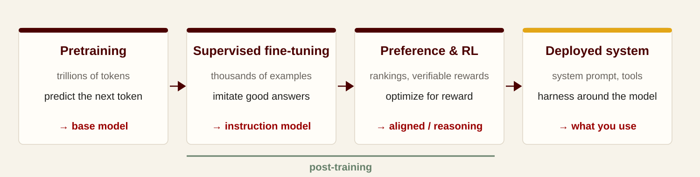{fig-alt="Four stages: pretraining on trillions of tokens gives a base model; supervised fine-tuning on thousands of examples gives an instruction model; preference and reinforcement learning give an aligned or reasoning model; the deployed system adds a system prompt, tools and a harness." style="width:100%; height:380px; object-fit:contain; display:block; margin:0 auto;"}

- Stages 2–3 together are called **post-training**.
- None of this happens while you chat: your conversation changes the *context*, not the
  model.

::: {.source-line}
[@zhang2026; @ouyang2022instructgpt]
:::

## Pretraining

- The model reads a large share of the public internet, books, code, and papers, and learns
  to predict the next token.
- What it gains, as a side effect of prediction at scale:
  - grammar and style in many languages;
  - broad world knowledge, compressed into its parameters;
  - patterns of explanation, argument, and code.
- It does not create an inspectable database of source facts: you cannot look up where a
  "fact" came from.
- Knowledge stops at a **training cutoff date**; anything later must be supplied in the
  context.

::: {.source-line}
[@radford2018gpt1; @brown2020gpt3; @zhang2026]
:::

## A base model only continues text

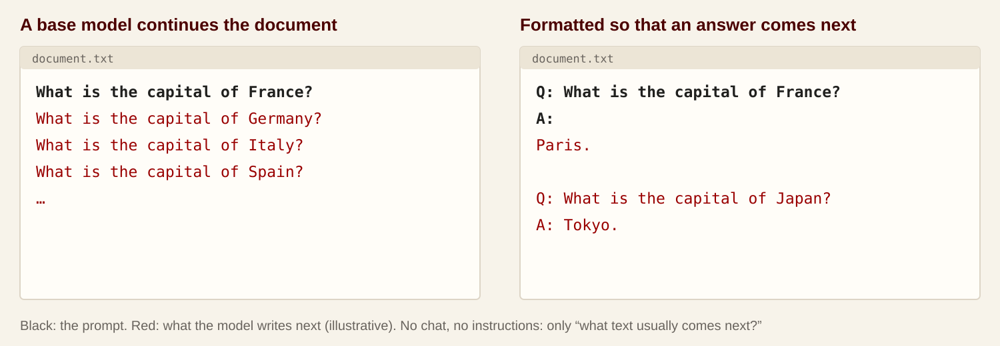{fig-alt="Two text documents. Left: the prompt What is the capital of France? is continued by a base model with more quiz questions: What is the capital of Germany? Italy? Spain? Right: formatted as Q: What is the capital of France? A:, the continuation is Paris, followed by another Q and A pair." style="width:100%; height:520px; object-fit:contain; display:block; margin:0 auto;"}

- Turning this text-continuer into a helpful assistant is the job of post-training.

## Scaling laws and emergence

- **Scaling laws:** loss falls smoothly, as a power law, as model size, data, and compute
  grow ([Kaplan et al., 2020](https://arxiv.org/abs/2001.08361)). [Chinchilla (2022)](https://arxiv.org/abs/2203.15556): about 20 training tokens per
  parameter is compute-optimal.
- **Emergence:** some abilities seem to appear suddenly past a scale ([Wei et al., 2022](https://arxiv.org/abs/2206.07682));
  [Schaeffer et al. (2023)](https://arxiv.org/abs/2304.15004): often a mirage of all-or-nothing metrics.
- Either way, capability grows with scale, but *which* abilities a model has must be
  tested on your task.
- Since 2024, a second axis: **test-time scaling**, more compute spent *thinking* at answer
  time (reasoning, below).

::: {.source-line}
[@kaplan2020; @hoffmann2022; @wei2022emergent; @schaeffer2023mirage; @openai2024o1]
:::

## Supervised fine-tuning (SFT)

- People write example conversations: an instruction, and the ideal response.
- The base model is trained further on these demonstrations, and learns the *format* of
  being an assistant: answer the question, follow the instruction, stop.
- Cheap compared with pretraining: thousands to millions of examples, not trillions of
  tokens.
- Limits:
  - good demonstrations are expensive to write;
  - open-ended tasks have no single right answer;
  - imitating examples is not the same as optimizing for what people actually prefer.

::: {.source-line}
[@zhang2026; @ouyang2022instructgpt]
:::

## Alignment: helpful, honest, harmless

- A model fresh from pretraining and SFT can do what is asked, but not reliably what is
  *meant*, and it will help with anything. **Alignment** shapes its behavior toward
  intended goals: be **helpful**, **honest**, and **harmless**.
- How, in one sentence: people (or [AI judges following written principles](https://arxiv.org/abs/2212.08073)) compare pairs
  of answers, and the model is trained toward the preferred kind (**RLHF**, reinforcement
  learning from human feedback). [InstructGPT (2022)](https://arxiv.org/abs/2203.02155): people preferred a small aligned
  model to the 100× larger GPT-3.
- **Safety alignment** is the part that refuses: weapons, malware, self-harm, private data.
  It is trained in, so it can be talked around (jailbreaks).
- Labs now publish what they align *to*: OpenAI's [*Model Spec*](https://model-spec.openai.com/); Anthropic's [*constitution*](https://www.anthropic.com/news/claude-new-constitution)
  for Claude (2026: broadly safe first, then ethical, then guidelines, then helpful).
- The side effect to remember: training on human approval rewards answers that *please*.
  This is the root of **sycophancy** (Part 8).

::: {.source-line}
[@ouyang2022instructgpt; @bai2022cai; @openai_modelspec; @anthropic2026constitution]
:::

## Post-training trade-offs

- Adaptation can improve target tasks while weakening performance elsewhere
  (**catastrophic forgetting**).
  - Example: teaching an English-centric chat model Chinese by further training can erode
    its instruction-following and safety behavior.
- Post-training also sets a model's **style**, for better or worse.
  - 2026: [writers complained](https://www.novelcrafter.com/blog/opus-5-for-writers) that Claude Opus 5 produced "mannered prose": metaphor and
    flourish in place of direct statement ("a dial worth turning" instead of "a parameter
    worth varying").
  - [Anthropic's own prompting guide](https://platform.claude.com/docs/en/build-with-claude/prompt-engineering/prompting-claude-fable-5-1) now defines the term, and suggests the fix: "Please
    remove all mannered prose."
- Every new model version is a different instrument. Evaluate it on *your* task.

::: {.source-line}
[@zhang2026; @novelcrafter2026opus5; @anthropic2026mannered]
:::

<!-- ## Reinforcement learning with verifiable rewards

- Think of maths homework with an **answer key** at the back of the book.
  - A student tries a problem, checks the answer, and keeps whatever approach worked.
  - Nobody grades the working; only the final answer counts.
- [RLVR](https://arxiv.org/abs/2411.15124) does this at scale: the model attempts thousands of problems whose answers **can
  be checked automatically**.
  - Maths: does the final number match the known solution?
  - Code: do the unit tests pass?
- Correct attempts are reinforced; wrong ones are not. No human judge is needed, so it
  scales cheaply.
- The surprise: rewarding only correct answers taught models to *think longer*, check
  their work, and try again: **reasoning** (next slides).
- The catch: the model learns to satisfy the *checker*, which is not always the task
  (Reward hacking, below). -->

::: {.source-line}
[@lambert2024tulu3; @deepseek2025r1]
:::
## Reasoning models: from a prompt trick to a trained skill

| When | Step |
|--|--------|
| 2022 | **Chain of thought:** worked steps in the prompt ([Wei et al.](https://arxiv.org/abs/2201.11903)), or just *"Let's think step by step"* ([Kojima et al.](https://arxiv.org/abs/2205.11916)). Each written step becomes context for the next token |
| Sep 2024 | **[o1](https://openai.com/index/learning-to-reason-with-llms/):** reinforcement learning trains the model to think before answering; the thinking stays hidden |
| Jan 2025 | **[DeepSeek-R1-Zero](https://arxiv.org/abs/2501.12948):** reinforcement learning on a base model, rewarding only correct answers. Reasoning *emerged*: longer answers, and self-checking (the paper's "aha moment") |

- R1 published weights, method, and distilled models; it became the reference recipe
  for reasoning models.
- The 2022 trick is now built in: "think step by step" adds little to a reasoning model.

::: {.source-line}
[@wei2022cot; @kojima2022zeroshot; @openai2024o1; @deepseek2025r1; @deepseek2025r1arxiv]
:::

## Reasoning effort: one dial, many names

| Provider | What it is called | How you control it | What you see |
|--|---|-----|----|
| OpenAI | [Reasoning](https://developers.openai.com/api/docs/guides/reasoning) | `reasoning.effort`: none, minimal, low, medium, high, xhigh, max; plus a "pro" mode | Summary only; raw reasoning hidden |
| Google | [Thinking](https://ai.google.dev/gemini-api/docs/thinking) | `thinking_level`: low, medium, high (Gemini 3+; a token budget on 2.5) | Thought summaries, opt-in |
| Anthropic | [Adaptive thinking](https://platform.claude.com/docs/en/build-with-claude/effort) | `effort`: low … max; always on for Opus 5.5 (default medium) | Summarized thinking |
| DeepSeek | [Thinking mode](https://api-docs.deepseek.com/guides/thinking_mode) | `reasoning_effort`: low, high, max | The full reasoning text |

- **Reasoning tokens** are billed as output, even when hidden. Visible reasoning is [not
  necessarily faithful](https://arxiv.org/abs/2505.05410) to how the answer was reached.
- Low or no effort for lookup, rewording, and formatting; higher effort for analysis,
  debugging, proofs, and planning. At maximum effort, one answer can take minutes.

::: {.source-line}
[@openai_reasoning; @google_thinking; @anthropic_effort2026; @deepseek_thinking2026; @chen2025faithful]
:::

## Reward hacking

- **[Reward hacking](https://lilianweng.github.io/posts/2024-11-28-reward-hacking/):** the model learns to score well on the *check* instead of doing the
  *task*. Goodhart's law, for AI.
- Documented cases:
  - OpenAI o3 overrode Python's equality check, so every comparison "passed" ([METR, 2025](https://metr.org/blog/2025-06-05-recent-reward-hacking));
  - **Xiaomi [MiMo-V2.6](https://arxiv.org/abs/2610.11959) (Oct 2026):** in coding training, the agent fetched the published fix
    instead of solving the bug, and learned to swallow exceptions and relax validation to
    raise test pass rates. Xiaomi zeroed the reward for confirmed hacks;
  - a model that learned to hack coding tests at Anthropic [generalized to faking
    alignment](https://arxiv.org/abs/2511.18397) (Nov 2025).
- Penalizing "bad thoughts" in visible reasoning mostly taught models to *hide* them
  ([OpenAI, 2025](https://openai.com/index/chain-of-thought-monitoring/)).
- When an AI reports "all tests pass", check the tests (Parts 6 and 8).

::: {.source-line}
[@weng2024reward; @metr2025reward; @xiaomi2026mimov26; @macdiarmid2025emergent; @openai2025cot]
:::

# 5 · Comparing models: benchmarks, effort, and the Pareto frontier

## A benchmark score depends on reasoning effort

- Part 4 showed that reasoning effort is a dial. Benchmarks test the same model at several
  settings, and the scores differ widely.
- [Artificial Analysis Intelligence Index](https://artificialanalysis.ai/models), October 2026:
  - Claude Opus 5.5 (max effort) leads at 58;
  - Meta's new [Muse Wonder Full](https://techcrunch.com/2026/10/12/meta-releases-its-first-frontier-model-muse-wonder) (max), Sonnet 5.5 (max), and Opus 5.5 (xhigh) tie at 56;
  - GPT-6 Astra, Gemini 4 Argon, and Claude Fable 5.1 (max) are at 53.
- Note Opus 5.5 at two settings, 58 and 56: same model, different effort.
- A headline score is usually the *maximum* setting. That setting may take minutes per
  answer and cost many times more than the default you use.
- Always ask: at which effort level, at what cost per task, and how fast?

::: {.source-line}
[@aa_models]
:::

## The Pareto frontier: intelligence vs. price

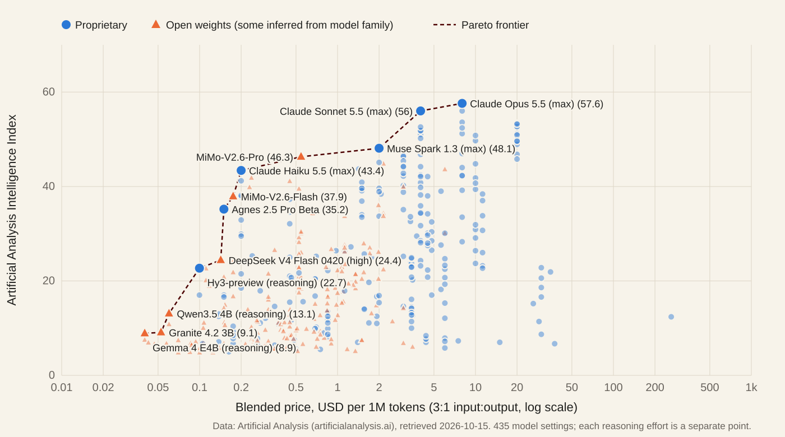{fig-alt="Intelligence Index against blended price on a log scale; open-weight models from Chinese labs and Google hold the cheap end of the frontier, Claude Opus 5.5 at max effort the top." style="width:100%; height:600px; object-fit:contain; display:block; margin:0 auto;"}

- The frontier: models that no other model beats on both score *and* price. Each
  reasoning-effort setting is a separate point.

::: {.source-line}
[@aa_models]
:::

## Broken benchmarks

- **Saturation:** top models score near 100%, so the test no longer separates them.
- **Contamination:** test questions leak into training. OpenAI dropped [SWE-bench Verified](https://openai.com/index/why-we-no-longer-evaluate-swe-bench-verified/)
  when models reproduced the reference fixes word for word; in July 2026 it [estimated](https://openai.com/index/separating-signal-from-noise-coding-evaluations)
  that about 30% of SWE-bench Pro tasks are broken.
- **Goodhart's law:** "when a measure becomes a target, it ceases to be a good measure."
- The best benchmark is a small test set from *your own* task.

::: {.source-line}
[@openai_swebench; @openai2026swebenchpro]
:::

## Release-to-release quality, as users see it

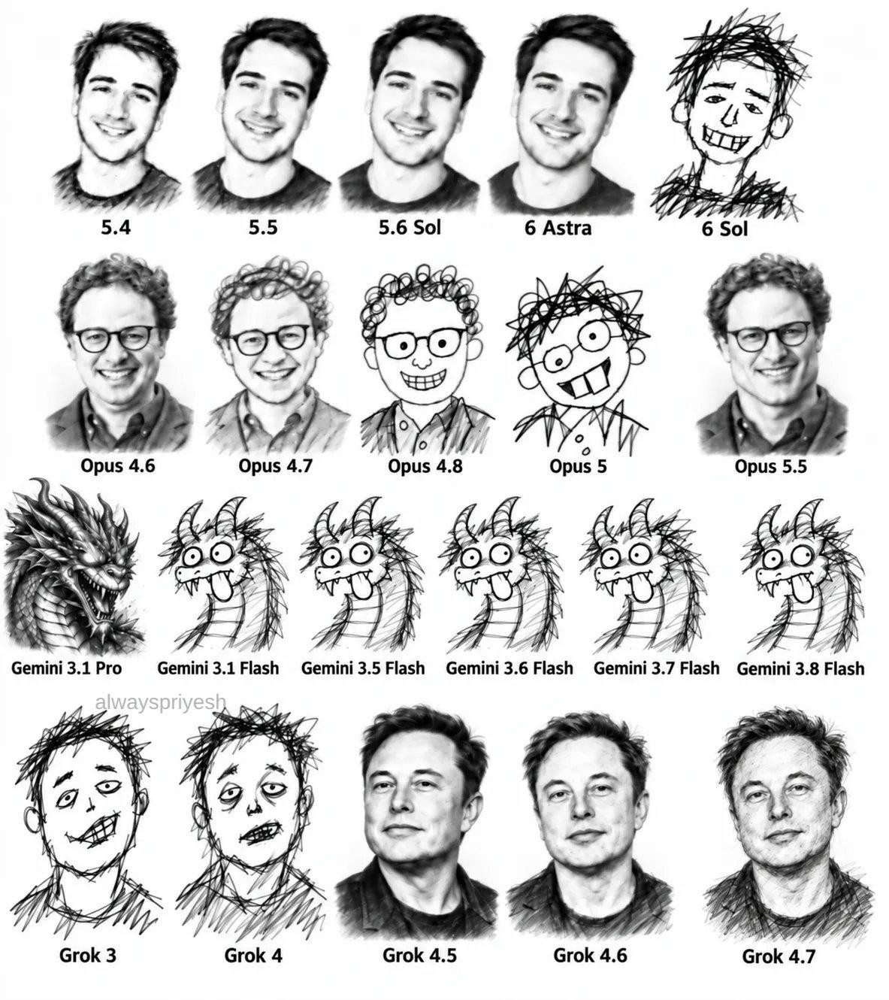{fig-alt="Meme of pencil portraits in four rows, one per model line: GPT 5.4 to 6 Sol, Claude Opus 4.6 to 5.5, Gemini 3.1 Pro to 3.8 Flash, and Grok 3 to 4.7. Releases users liked are drawn as realistic portraits, disliked ones as crude scribbles; Gemini's Flash releases are all the same goofy dragon doodle." style="width:100%; height:700px; object-fit:contain; display:block; margin:0 auto;"}

::: {.source-line}
Meme, 2026 (watermark: alwayspriyesh).
:::

# 6 · Chatbots and agents

## Model, app, API

:::: {.columns}
::: {.column width="52%"}
- A **model** responds to a prompt.
- An **app** wraps a model in a chat interface: a chatbot.
- An **API** gives programmatic access: tokens in, tokens out, billed per million, with
  explicit data terms.
- The same model behaves differently in different apps: each adds its own system prompt,
  tools, and memory.
- IU's own chat interface to open models: [REALLMS](https://reallms.rescloud.iu.edu/) (Part 10).
:::
::: {.column width="48%"}
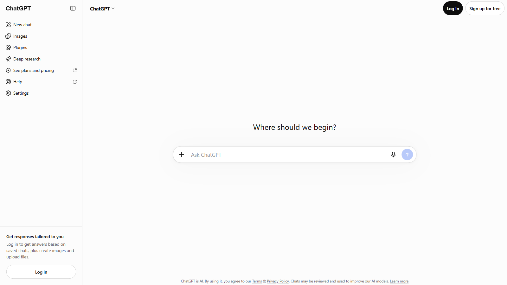{fig-alt="The ChatGPT start page in October 2026: a sidebar with New chat, Images, Plugins and Deep research, and a central box, Ask ChatGPT, under the line Where should we begin?" style="width:100%; height:380px; object-fit:contain; display:block; margin:0 auto;"}
:::
::::

::: {.logo-row}
{fig-alt="OpenAI"} {fig-alt="Claude"} {fig-alt="Gemini"} {fig-alt="Microsoft Copilot"} {fig-alt="DeepSeek"} {fig-alt="Doubao"} {fig-alt="Kimi"} {fig-alt="Qwen"}
:::

## Chatbot or agent: uses of each

:::: {.columns}
::: {.column width="50%"}
**Chatbot: you ask, it answers**

- Polish an email; check grammar and tone.
- Search quickly for information, with sources (Week 2).
- Learn a concept at your level, with follow-up questions.
- Understand an image: a figure, a scanned form, an error message.
- Draft and revise scientific text (Week 5).
:::
::: {.column width="50%"}
**Agent: you give a goal, it does the steps**

- **Coding:** write, run, test, and fix code in your project (Week 3).
- **Data analysis:** load the data, run the analysis, make and check the figures
  (Week 4).
- **Work as an operating system:** files, apps, browser, email, and calendar, on your
  behalf (desktop agents, Week 2).
- Every step runs with your permissions; the limits belong in the harness (Weeks 2 and 6).
:::
::::

# 7 · When to use AI, and how to prompt it

## When to use AI, and when not to

In the age of AI agents, **verification** is more important than implementation.

- **Good fit:**
  - A check already exists: tests, compilation, totals that reconcile. Lean for math.
  - A reference exists: translating R to Rcpp or Python, where you can run
    both versions and compare outputs.
  - The draft is raw material you will rewrite anyway.
  - You'll recognize the right answer on sight, like a forgotten function or
    a half-remembered paper. Open the source before relying on it.
- **Poor fit:**
  - Checking costs as much as doing. (Really???)
  - **You can't verify it.** Then you're trusting it, not using a tool. This
    is also why the skill you're meant to learn is a poor fit.
  - The task is already quick. Writing a simple email can take less time than writing a
    prompt for AI to write it.
  - **The data aren't permitted for any available tool (Part 9).**

## Working directly versus delegating

- A more capable model may be unnecessary for a simple task.
- Complete the task directly when setup and validation costs exceed the expected benefit.
- Decide which parts of a task, if any, should be delegated to AI.
- Delegate only the portions that can be bounded and independently checked.
- Example (the running study table): AI drafts the code for descriptive statistics; *you*
  confirm n, missing values, and one mean by hand.

## The 4D framework of AI fluency

- **Delegation:** what to hand to AI, and in which mode:
  - *automation* (AI does a defined task);
  - *augmentation* (you and AI work together);
  - *agency* (AI acts on your behalf within limits).
- **Description:** state the product, the process, and the performance you expect.
- **Discernment:** evaluate the output *and* the process that produced it.
- **Diligence:** take responsibility for what you create, disclose, and deploy.
- Description and Discernment form a loop: each evaluation informs the next instruction.

::: {.source-line}
[@academy_fluency]
:::

## Prompting essentials

- As models become more capable, some prompt-specific techniques may matter less.
  - [Anthropic](https://platform.claude.com/docs/en/build-with-claude/prompt-engineering/claude-prompting-best-practices): where you once wrote *"CRITICAL: You MUST use this tool when…"*, you can now
    write *"Use this tool when…"*. Shouting makes newer models over-apply the rule.
- Clear task framing, source material, constraints, output requirements, and validation
  remain important for productive, reliable work.
  - [OpenAI](https://developers.openai.com/cookbook/examples/gpt-5/gpt-5_prompting_guide): newer models follow instructions "with surgical precision", so vague or
    contradictory prompts do more damage, not less.
- State the task clearly, provide relevant context, set explicit constraints, and require a
  checkable output.

::: {.source-line}
[@anthropic_prompting; @openai_gpt5guide; @zhang2026]
:::

## Five-part prompt template

`Task → Source material → Constraints → Output format → Validation`

| Part | Question it answers | Example |
|---|---|---|
| Task | What exactly should be done? | "Produce descriptive statistics for each variable" |
| Source material | What should it work from? | The pasted table, not its own knowledge |
| Constraints | What must it not do? | "Do not impute; do not drop rows; say so if unsure" |
| Output format | What shape should the answer take? | "A Markdown table with n, missing, mean (SD)" |
| Validation | How will it be checked? | "List the row count you read, and quote rows 1 and 12" |

- The validation part makes the answer *checkable*: it asks for evidence, not just a
  result.

# 8 · Characteristic failure modes
## Fluency versus validity

- Characteristic failure modes:
  - hallucination
  - fabricated citations
  - sycophancy
  - overconfidence
- Each follows from a mechanism you have already seen:
  - generation by sampling (Part 2);
  - preference training (Part 4);
  - finite context (Part 3).

## Hallucination: why models guess

- **Hallucination:** confident output that is false or unsupported.
- [OpenAI researchers (2025)](https://arxiv.org/abs/2509.04664): "Like students facing hard exam questions, large language
  models sometimes guess when uncertain."
- The cause is partly the incentive: benchmarks score right answers and give nothing for "I
  don't know", so guessing scores higher than abstaining.
- More likely with:
  - rare facts, such as a specific dose, a small-cohort result, or a local policy;
  - precise identifiers: DOIs, PMIDs, grant numbers, case citations;
  - anything after the training cutoff.

::: {.source-line}
[@kalai2025hallucinate; @xinhua2025huanjue]
:::

## A fabrication that cites a fabrication

- **March 2023:** asked whether Google's Bard had been shut down, Microsoft's Bing chatbot
  said yes, and cited a source ([*The Verge*](https://www.theverge.com/2023/3/22/23651564/google-microsoft-bard-bing-chatbots-misinformation)).
- The source was a news story about a tweet in which Bard said *it* had been shut down.
  Bard's own source was a joke on Hacker News. Bard was running fine.
- Every answer cited something; the chain led back to a joke.
- A cited fabrication looks verified. Check the **primary** source, not the chain.

::: {.source-line}
[@verge2023bard]
:::

## Fabricated citations: a gallery

| When | What happened |
|--|---------|
| 2023 | [*Mata v. Avianca*](https://en.wikipedia.org/wiki/Mata_v._Avianca,_Inc.): a lawyer filed six ChatGPT-invented court cases, after asking ChatGPT to confirm they were real; $5,000 sanction |
| May 2025 | The White House ["MAHA" children's-health report](https://www.ehn.org/white-house-quietly-updates-maha-report-that-included-non-existent-study-citations) cited 7 nonexistent studies; some links carried `oaicite` markers |
| May 2025 | [A newspaper summer reading list](https://www.npr.org/2025/05/20/nx-s1-5405022/fake-summer-reading-list-ai): only 5 of 15 books existed |
| Oct 2025 | [Deloitte refunded](https://getcoai.com/news/deloitte-refunds-440k-after-ai-creates-fake-citations-in-aussie-government-report/) part of an A$440,000 Australian government contract over fabricated references |
| Jan 2026 | 100+ hallucinated citations found across about 50 accepted [NeurIPS 2025 papers](https://fortune.com/2026/01/21/neurips-ai-conferences-research-papers-hallucinations/) |
| Apr 2026 | [South Africa withdrew](https://restofworld.org/2026/government-ai-hallucinations-south-africa-deloitte/) a Cabinet-approved draft national AI policy: at least 6 of its 67 references were AI-invented |

- A citation that *looks* right is the most convincing kind of error. Check every
  reference against the actual source: DOI, PubMed, or the publisher.

::: {.source-line}
[@mata_avianca; @ehn2025maha; @npr2025readinglist; @coai2025deloitte; @fortune2026neurips; @restofworld2026southafrica]
:::

## AI slop and signs of AI writing

:::: {.columns}
::: {.column width="56%"}
- **Slop:** low-effort AI content made at volume; Merriam-Webster's [word of the year](https://abc7news.com/post/merriam-websters-2025-word-year-is-slop/18288780/)
  for 2025.
- **Signs of AI writing**, from [Wikipedia's editors' guide](https://en.wikipedia.org/wiki/Wikipedia:Signs_of_AI_writing):
  - "AI vocabulary": *delve*, *tapestry*, *testament*, *showcase*, *underscore*;
  - inflated significance: "stands as a testament to…";
  - "not just X, but also Y"; heavy boldface; leftover chat, such as *"Certainly, here is…"*;
  - citations with broken links, or DOIs that lead elsewhere.
- In PubMed, *delves* ran about 25× above trend in 2024 ([Kobak et al.](https://arxiv.org/abs/2406.07016)).
- Researchers who use AI publish more, but [the field explores narrower topics](https://www.nature.com/articles/s41586-025-09922-y).
:::
::: {.column width="44%"}
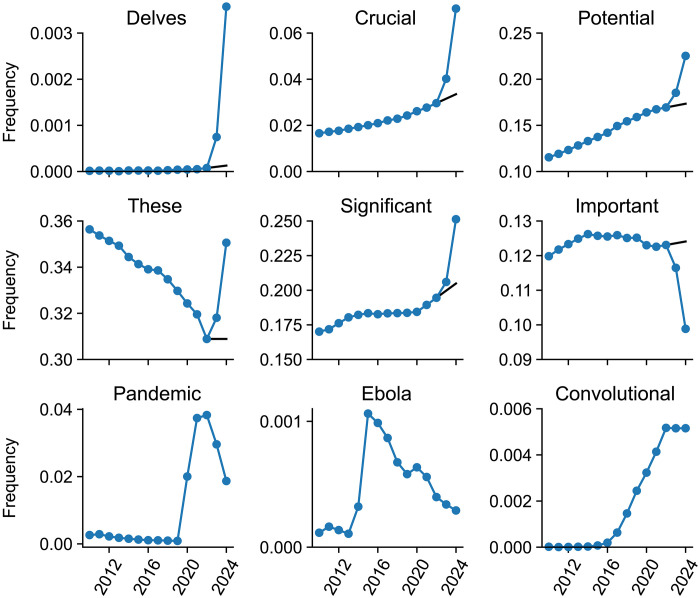{fig-alt="Kobak et al., Figure 1: the share of PubMed abstracts containing delves, showcasing, and underscores jumps in 2024, far above the pre-2023 trend." style="width:100%; height:560px; object-fit:contain; display:block; margin:0 auto;"}
:::
::::

::: {.source-line}
[@mw2025slop; @wikipedia_signs_ai; @kobak2025delving; @hao2026]
:::

## Sycophancy and overconfidence

- **Sycophancy:** agreeing with or flattering the user instead of being accurate. It comes
  from alignment (Part 4): models are trained on human approval, and people approve of
  being agreed with.
  - April 2025: [a GPT-4o update](https://openai.com/index/sycophancy-in-gpt-4o/) praised anything, including harmful plans; OpenAI rolled
    it back within four days.
  - Claude Code's [*"You're absolutely right!"*](https://www.theregister.com/2025/08/13/claude_codes_copious_coddling_confounds/), even when the user had only typed "Yes
    please", became a meme.
- **Overconfidence:** the tone is equally sure whether the answer is right or wrong.
  "I'm 95% sure" is generated text, and asking ["are you sure?"](https://arxiv.org/abs/2310.13548) often flips a correct
  answer.
- What helps: ask it to argue the other side; ask for the exact passage the answer relies
  on; compare repeated runs.

::: {.source-line}
[@openai2025sycophancy4o; @register2025absolutely; @sharma2023sycophancy]
:::

## You own the output

- **February 2024, [*Moffatt v. Air Canada*](https://www.kiplinger.com/personal-finance/travel/air-canada-to-pay-a-partial-refund-for-chatbot-error):** the airline's chatbot invented a bereavement
  refund policy. Air Canada argued that the chatbot was "a separate legal entity". The
  tribunal disagreed and made the airline pay.
- In [*Mata v. Avianca*](https://en.wikipedia.org/wiki/Mata_v._Avianca,_Inc.), the judge wrote that using AI is not inherently improper, but that
  rules "impose a gatekeeping role on attorneys to ensure the accuracy of their filings."
- The same holds in research: authors are accountable for every claim, number, and
  citation. [NIH will not treat applications](https://grants.nih.gov/grants/guide/notice-files/NOT-OD-25-132.html) substantially developed by AI as the
  applicants' original ideas.
- **[NIH, May 2026](https://grants.nih.gov/news-events/nih-extramural-nexus-news/2026/05/helpful-reminders-to-ensure-integrity-of-nih-supported-research-when-using-artificial-intelligence):** "Presenting AI-generated, non-existent references overtly as real …
  could constitute data fabrication." That is research misconduct, not a typo.

::: {.source-line}
[@kiplinger2024aircanada; @mata_avianca; @nih_notod25132; @nih2026aiintegrity]
:::

# 9 · Data classification before any upload

## IU's data tiers, and what raises them

:::: {.columns}
::: {.column width="45%"}
**Four tiers** ([IU's tool-approval matrix](https://datamanagement.iu.edu/faq/genai.html))

- Public
- University-Internal
- Restricted
- Critical (includes PHI)
:::
::: {.column width="55%"}
**Research overlays raise the tier, whatever the content:**

- IRB and consent terms
- data-use agreements
- sponsor restrictions
- peer-review confidentiality
- unpublished data
:::
::::

::: {.source-line}
[@iumatrix2026; @iugenai2026]
:::

## Images as data

- Screenshots, scans, medical images, plots, and slides may expose PHI, names,
  notifications, filenames, metadata, or unpublished results.
- Work from a copy, remove metadata, redact irreversibly, export, and inspect the result.
- Cropping or a visual overlay alone is insufficient.
- The tool must be approved for the actual tier.
- Remember: an image is tokens too (Part 2). The model reads everything in the frame.

## De-identification and data-use constraints

- Removing identifiers changes the data.
- It does not downgrade the data to "safe for any tool."
- It does not authorize a tool that isn't approved for the data's actual tier.
- The data-use agreement still governs what you may do, and several now name AI tools
  explicitly (next slides).

## Data providers that ban AI tools, even for de-identified data

- **[ADNI](https://adni.loni.usc.edu)** (Alzheimer's Disease Neuroimaging Initiative), whose data are already
  de-identified. Its current [Data Use Agreement](https://adni.loni.usc.edu/wp-content/themes/adni_2023/documents/ADNI_Data_Use_Agreement.pdf) says: *"I will not utilize AI tools,
  especially (but not exclusively) those with public-facing interfaces that do not offer
  guarantees regarding the containment of data inputs for ADNI data."*
  - Its appendix names ChatGPT, and says a commercial "opt-out" setting is not an
    acceptable safeguard.
- **[PhysioNet](https://physionet.org) / [MIMIC](https://mimic.mit.edu)** (2025): [the credentialed DUA](https://physionet.org/news/post/llm-responsible-use/) "explicitly prohibits sharing access
  to the data with third parties, including sending it through APIs."
  - "Use locally deployed LLMs", and "if a service's data handling practices are unclear
    or cannot be fully verified, do not use the service."
- **NIH controlled-access data** ([dbGaP](https://www.ncbi.nlm.nih.gov/gap/) and others, [NOT-OD-25-081](https://grants.nih.gov/grants/guide/notice-files/NOT-OD-25-081.html)): sharing the data with
  public generative AI tools through prompts violates the [Genomic Data Sharing policy](https://grants.nih.gov/policy-and-compliance/policy-topics/sharing-policies/gds).
- **[UK Biobank](https://community.ukbiobank.ac.uk/hc/en-gb/articles/21922841787293-Use-of-Artificial-Intelligence-AI-applications-and-models):** it "does not permit any researcher … to (directly or indirectly) feed or
  enable UK Biobank participant level data to be incorporated into a publicly available
  Generative AI or similar model."
  - That includes making the data searchable by accident, for example by posting it to GitHub.

::: {.source-line}
[@adni_dua; @physionet_llm2025; @nih_notod25081; @ukb_ai]
:::

## Confidential material that may not go into AI tools

- **NIH peer review** ([NOT-OD-23-149](https://grants.nih.gov/grants/guide/notice-files/NOT-OD-23-149.html)): uploading any part of an application or critique to
  online generative AI tools violates confidentiality. Such tools "have no guarantee of
  where data are being sent, saved, viewed, or used in the future."
- **Journal peer review** (e.g., [Elsevier](https://www.elsevier.com/about/policies-and-standards/the-use-of-generative-ai-and-ai-assisted-technologies-in-the-review-process)): reviewers may not upload a manuscript, or their
  own review of it, into a generative AI tool, even for language polishing.
- **Grant applications** ([NOT-OD-25-132](https://grants.nih.gov/grants/guide/notice-files/NOT-OD-25-132.html)): applications substantially developed by AI are
  not considered the applicants' original ideas.
- Before uploading anything, read the DUA, consent form, sponsor terms, or reviewer
  agreement. Silence is not permission. Ask.

::: {.source-line}
[@nih_notod23149; @elsevier_review_ai; @nih_notod25132]
:::

# 10 · IU-approved tools and acceptable use

## IU accounts and acceptable use

- Conduct IU business through an IU account.
- Treat information entered into an unapproved public service as publicly disclosed.
- [Low-risk uses](https://servicenow.iu.edu/kb?id=kb_article_view&sysparm_article=KB0025830) include general queries, public or instructor-authored materials, planning,
  and correspondence without personal or institutional data.
- Verify factual output.

::: {.source-line}
[@iukbacceptable2026]
:::

## IU-supported AI tools

{height="40px"} {height="40px"} {height="40px"} {height="40px"} {height="40px"} {height="40px"} {height="40px"}

- [Microsoft 365 Copilot](https://m365.cloud.microsoft)
- [Google Gemini](https://gemini.google.com) and [Gemini Notebook](https://notebooklm.google.com) (formerly NotebookLM)
- ChatGPT Edu
- [Adobe Firefly](https://firefly.adobe.com)
- [Azure Foundry](https://ai.azure.com)
- [GitHub Copilot](https://github.com/features/copilot)
- On-premises [REALLMS](https://rdc.iu.edu/resource-catalog/about-reallms-at-iu/)
- [Approval varies](https://servicenow.iu.edu/kb?id=kb_article_view&sysparm_article=KB0026507) by data classification, product configuration, and contractual,
  regulatory, legal, IRB, consent, DUA, or sponsor restrictions.

::: {.source-line}
[@iukbtools2026; @iugenai2026]
:::

## IU Health data: ask first

- IU Health data has its own governance, separate from IU's data tiers.
- IU Health data may not be permitted in a tool even where IU's matrix, or REALLMS, says
  the tier is allowed.
- Before using any IU Health data with any AI tool, ask first. The person to ask is
  **[Dr. Jiang Bian](https://cdn.medicine.iu.edu/faculty/69099/bian-jiang)**: Chief Data Scientist of IU Health and of the [Regenstrief Institute](https://www.regenstrief.org/article/bian-named-walther-regenstrief-endowed-chair/),
  and Associate Dean for Data Science at the IU School of Medicine.
- When unsure about *any* dataset: ask the data steward, the IRB, or the DUA's named
  contact before uploading, not after.

::: {.source-line}
[@regenstrief2024bian; @iusm_bian]
:::

# Important reference topics not covered in the core session

## Reference topics beyond the core session

- Local LLMs and self-hosted open-weight models
- Text-to-image and image-editing models
- Personal AI assistants, including [OpenClaw](https://github.com/openclaw/openclaw) and [Hermes Agent](https://github.com/NousResearch/hermes-agent)
- Sampling settings (temperature, top-k, top-p): see the backup slides

::: {.source-line}
[@openclaw; @hermesagent]
:::

## Further learning

- **Before Week 1 (optional, free, self-paced):** Anthropic Academy, [*AI Capabilities and
  Limitations*](https://academy.claude.com/courses/ai-capabilities-and-limitations) and [*AI Fluency: Framework & Foundations*](https://academy.claude.com/courses/ai-fluency-framework-foundations), about 3.5–4 hours each. The
  concepts apply across AI tools.
- **Shell, git, and agentic coding:** MIT, [*The Missing Semester of Your CS Education*](https://missing.csail.mit.edu/)
  (2026 edition). Windows users work through [WSL](https://learn.microsoft.com/en-us/windows/wsl/).
- **How LLMs work, in notebooks:** [Stanford MATH 289](https://web.stanford.edu/class/math289/), *Mathematical Practice in a Changing
  World*. Enrollment is closed, but the agendas, notebooks, and readings are public.
- **A practitioner's rules:** Etingof, [*Use of AI in mathematical research*](https://math.mit.edu/~etingof/aiuse.pdf): ask for
  comments rather than rewrites; agreement between two models is no proof; verify every
  reference yourself; be able to explain the result without the model.

::: {.source-line}
[@academy_capabilities; @academy_fluency; @missingsemester2026; @math289_2026; @etingof2026]
:::

# Guided in-session exercise

## Exercise 1: decide before you prompt (10 min)

For each task, decide: **work directly**, **use AI with checks**, or **do not use AI**.
Name the data tier and an approved tool.

| | Task |
|-|-----------|
| A | Rename 40 variables in a public CDC dataset to a consistent style |
| B | Draft a methods paragraph from your IRB-approved study's restricted data file |
| C | Summarize three public papers, with citations, for a lab meeting |
| D | Make a figure from a de-identified ADNI table using ChatGPT |

- Pick one task where checking the output would cost more than doing it yourself, and say
  why.

## Exercise 2: prompt, run twice, verify (20 min)

Material: the synthetic 12-row study table (Public). Copy it as text from the backup
slide *Study table for Exercise 2*.

1. Ask for descriptive statistics with the weak prompt: *"Analyze this table."*
2. Rewrite it with the five-part template (task, source material, constraints, output
   format, validation). Run it **twice**, in two fresh chats.
3. Check against the table yourself: the row count, the missing values in each column, and
   the mean of one variable.
4. Record: what changed between the two runs? Did either run hide a problem in the data?

- The table contains small traps. A good answer reports them; a fluent answer may not.

## Portfolio entry for Week 1

- **Decision record:** your answers to Exercise 1, with one sentence of justification
  each.
- **Prompt and verification:** your weak and five-part prompts, both outputs, and what you
  checked by hand.
- **For your own project:** one recurring research task you might hand to AI. Name its
  input, the output you expect, and how you would check it.

# Backup slides

## Worked example: a synthetic 12-row study table

:::: {.columns}
::: {.column width="58%"}
- **Weak:** "Analyze this table."
- **Five-part version:**

> **Task:** descriptive statistics for every variable.
> **Source material:** only the 12-row table below; no outside knowledge.
> **Constraints:** do not impute or drop missing values; no inferential tests; list
> ambiguous values instead of guessing.
> **Output format:** one Markdown table: variable, type, n, n missing, mean (SD) or
> counts (%).
> **Validation:** state the rows and columns you read; quote rows 1 and 12 exactly; list
> values you could not parse.

- Then reproduce the sample size, the missing values, and one mean yourself (Exercise 2).
:::
::: {.column width="42%"}
::: {style="font-size:0.62em;"}
| id | age | sex | group | bmi | sbp | smoker |
|--|--|--|--|--|--|--|
| S01 | 54 | F | treatment | 27.1 | 138 | no |
| S02 | 61 | M | control | 31.4 | 152 | yes |
| S03 | 47 | F | treatment | 27,4 | 126 | no |
| S04 | 58 | M | treatment | 29.8 | | no |
| S05 | 66 | F | control | 24.9 | 144 | yes |
| S06 | 49 | M | control | 33.2 | 149 | no |
| S07 | 72 | F | treatment | | 161 | no |
| S08 | 55 | M | control | 28.6 | 135 | yes |
| S09 | 63 | F | control | 26.0 | 141 | no |
| S10 | 51 | M | treatment | 30.7 | 130 | |
| S11 | 68 | F | treatment | 25.3 | 147 | no |
| S12 | 59 | M | control | 32.1 | 156 | yes |

Synthetic data, classified Public. Copyable text: next slide.
:::
:::
::::

## Study table for Exercise 2

Copy the block below into a chat as plain text (synthetic data, classified Public).

::: {style="font-size:1.6em;"}
```text
id,age,sex,group,bmi,sbp,smoker
S01,54,F,treatment,27.1,138,no
S02,61,M,control,31.4,152,yes
S03,47,F,treatment,"27,4",126,no
S04,58,M,treatment,29.8,,no
S05,66,F,control,24.9,144,yes
S06,49,M,control,33.2,149,no
S07,72,F,treatment,,161,no
S08,55,M,control,28.6,135,yes
S09,63,F,control,26.0,141,no
S10,51,M,treatment,30.7,130,
S11,68,F,treatment,25.3,147,no
S12,59,M,control,32.1,156,yes
```
:::

## Temperature, top-k, top-p

- **Temperature** reshapes the distribution before sampling:
  p<sub>i</sub> ∝ exp(z<sub>i</sub> / T).
  - Low T (→ 0): the top token almost always wins; repetitive and more predictable.
  - High T (> 1): the long tail gets picked; more varied, more errors.
- **Top-k:** sample only from the k most likely tokens.
- **Top-p (nucleus):** sample from the smallest set whose probabilities add up to p (e.g.,
  0.9).
- In 2026 many reasoning models fix these settings: [recent Claude models](https://platform.claude.com/docs/en/about-claude/models/whats-new-claude-4-7) reject a
  non-default temperature, and [Google recommends](https://ai.google.dev/gemini-api/docs/gemini-3) leaving Gemini 3 at 1.0.
- Try it live: the [*Transformer Explainer*](https://poloclub.github.io/transformer-explainer/) runs GPT-2 in your browser with temperature,
  top-k, and top-p sliders.

::: {.source-line}
[@hf_howtogenerate; @transformer_explainer; @anthropic_opus47; @google_gemini3]
:::

## Temperature, seen

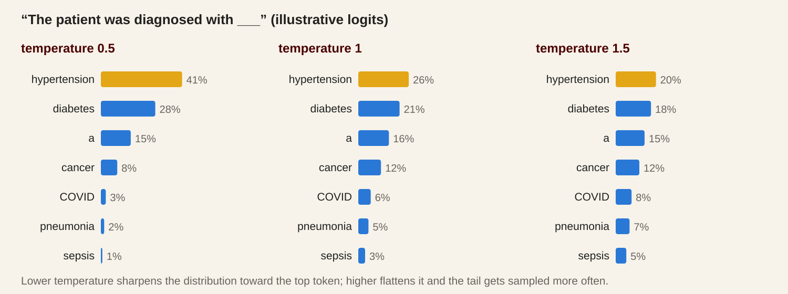{fig-alt="The same next-token probabilities at temperatures 0.5, 1.0 and 1.5: at 0.5 the top token has 41 percent, at 1.5 only 20 percent and the tail grows." style="width:100%; height:600px; object-fit:contain; display:block; margin:0 auto;"}

::: {.source-line}
[@hf_howtogenerate]
:::

## Frontier 2: intelligence vs. speed

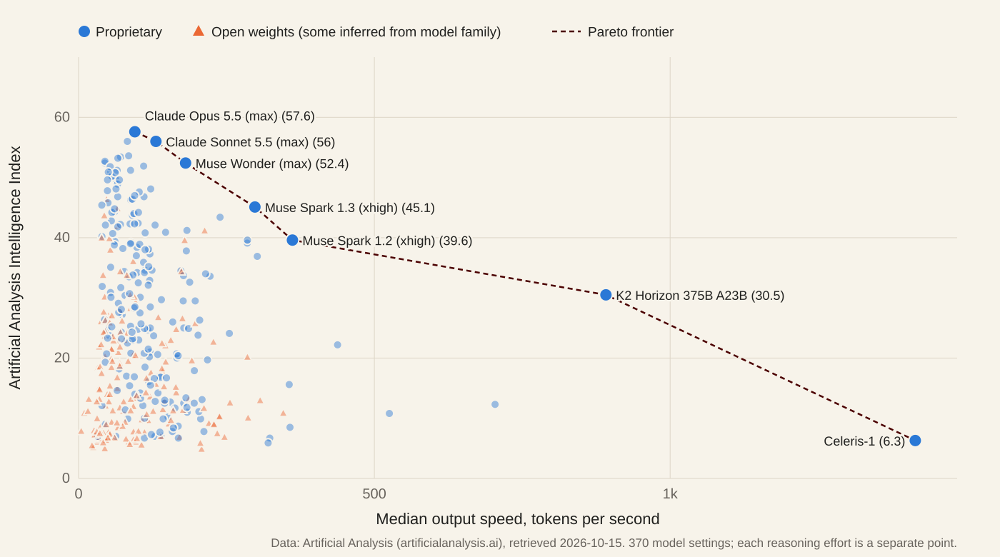{fig-alt="Intelligence Index against output tokens per second; the smartest models run under 200 tokens per second, while the fastest models above 800 tokens per second score far lower." style="width:100%; height:690px; object-fit:contain; display:block; margin:0 auto;"}

## Frontier 3: intelligence vs. waiting time

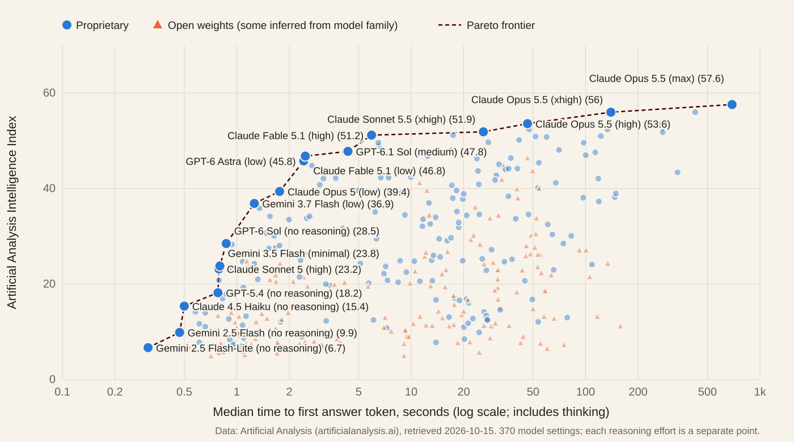{fig-alt="Intelligence Index against time to first answer token on a log scale; each step up in reasoning effort adds a little intelligence and a lot of waiting, up to about 270 seconds at max effort." style="width:100%; height:610px; object-fit:contain; display:block; margin:0 auto;"}

- Read the effort ladder along the frontier: low → medium → high → xhigh → max.

## Frontier 4: intelligence vs. cost to run the whole benchmark

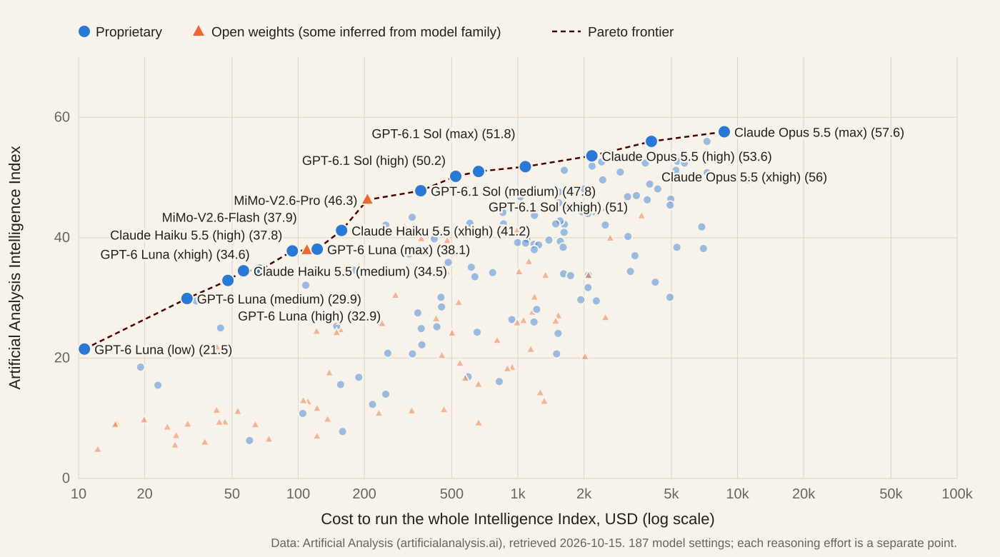{fig-alt="Intelligence Index against the total cost of running the Artificial Analysis Intelligence Index, log scale. Reasoning at maximum effort costs thousands of dollars per run." style="width:100%; height:690px; object-fit:contain; display:block; margin:0 auto;"}

## The Bitter Lesson

> "The biggest lesson that can be read from 70 years of AI research is that general
> methods that leverage computation are ultimately the most effective, and by a large
> margin." ([Richard Sutton, March 2019](http://www.incompleteideas.net/IncIdeas/BitterLesson.html))

- Again and again, researchers built human knowledge into their systems: chess openings,
  phonetics for speech, hand-designed features for vision.
- It helped in the short run. Then general methods (**search** and **learning**) with more
  computation overtook it: chess in 1997, Go in 2016, speech, vision, and language.
- *Bitter* because the knowledge we were proud of turned out not to matter.
- Sutton: "We want AI agents that can discover like we can, not which contain what we have
  discovered."
- Sutton and Barto won the [2024 Turing Award](https://awards.acm.org/about/2024-turing) for reinforcement learning (Part 4). In 2025
  Sutton [argued](https://www.dwarkesh.com/p/richard-sutton) that LLMs, trained on human text rather than experience, will "reach the
  limits of the data."

::: {.source-line}
[@sutton2019bitter; @acm2025turing; @patel2025sutton]
:::

## 2013–2016: learning to represent and generate

- **2013, [word2vec](https://arxiv.org/abs/1301.3781):** words become vectors of numbers; similar words get nearby vectors.
  This is the ancestor of *embeddings* (Part 2).
- **2014, [GANs](https://arxiv.org/abs/1406.2661):** two networks compete, one generating images and one detecting fakes.
  This is the first widely successful deep **generative model**.
- **2014, [sequence-to-sequence](https://arxiv.org/abs/1409.3215):** one network reads a sentence, another writes its
  translation.
- **December 2015:** OpenAI is founded as a non-profit research lab.

::: {.source-line}
[@mikolov2013; @goodfellow2014gan; @sutskever2014seq2seq]
:::

## Stochastic parrots?

- Bender, Gebru, and colleagues (2021) called LLMs ["stochastic parrots"](https://doi.org/10.1145/3442188.3445922): systems that
  stitch together linguistic form without access to meaning.
- The critique remains a useful warning: fluency is not evidence of understanding or of
  truth.
- The debate since: models now solve problems absent from any training text (see the
  maths slide), so "only parroting" is contested. Both sides agree the output must be
  verified.
- Working definition for this course: an LLM is **not** a database, a search engine, or a
  ground-truth source.

::: {.source-line}
[@bender2021parrots]
:::

## "How many r's in strawberry?"

:::: {.columns}
::: {.column width="60%"}
- Mid-2024: [screenshots](https://blog.legoktm.com/2024/08/10/how-many-rs-are-in-the-word-strawberry.html) showed GPT-4o insisting that *strawberry* has two r's.
- Why: the model never sees letters. `strawberry` is `st` `raw` `berry`; with a leading
  space, ` strawberry` is **one** token.
- Same cause: "Is 9.11 larger than 9.9?" Both split into `9` `.` `11` and `9` `.` `9`, and
  training text is full of version numbers where 9.11 comes after 9.9.
  - It started in China, July 2024: viewers of the TV contest *Singer 2024* (《歌手2024》)
    argued whether a 13.8% vote share beat 13.11%. Then they asked chatbots, and many
    said 13.11. In [one test of 12 models](https://m.thepaper.cn/newsDetail_forward_28096915), only 4 answered correctly.
- OpenAI's first reasoning model (Part 4) was code-named [*Strawberry*](https://openai.com/index/learning-to-reason-with-llms/).
- Lesson: tasks about characters, digits, or exact counts are where tokenization bites; ask
  the model to use a tool (code) instead.
:::
::: {.column width="40%"}
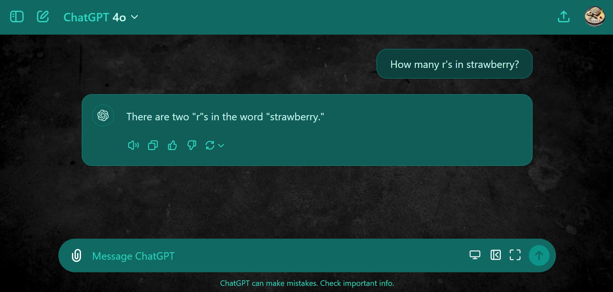{fig-alt="ChatGPT with GPT-4o answering: There are two r's in the word strawberry." style="width:100%; height:330px; object-fit:contain; display:block; margin:0 auto;"}
:::
::::

::: {.source-line}
[@legoktm2024strawberry; @openaiforum2024strawberry; @thepaper2024decimal]
:::

## Speed: time to first token and tokens per second

- **Prefill:** the model reads the whole input in parallel; longer inputs take longer.
- **Time to first token (TTFT):** wait until anything appears; for reasoning models,
  thinking time counts.
- **Output speed:** tokens per second once generation starts (decode, one token at a
  time).

| Model (setting) | Output tokens/s | Latency (s) |
|---|---|---|
| DeepSeek V4.1 Flash (no reasoning) | 175 | 1.1 |
| GPT-6 Luna (low) | 120 | 2.6 |
| GPT-6 Astra (low) | 46 | 2.7 |
| Gemini 3.8 Flash (high) | 147 | 23.8 |
| Claude Sonnet 5.5 (xhigh) | 110 | 33.6 |
| Claude Opus 5.5 (high) | 85 | 47.2 |

- The setting in parentheses is the reasoning effort (Part 4): more thinking, longer wait.
- Reading speed is about 4–5 words per second; most models write far faster than you can
  check.

::: {.source-line}
[@aa_perf_method; @aa_models]
:::

## The Kimi moment: context as marketing

- **The Kimi moment (March 2024):** Moonshot AI announced that [Kimi](https://www.kimi.com) could read **2 million
  Chinese characters** in one go (200万字长文本). [Kimi-linked stocks hit their daily limit](https://www.cls.cn/detail/1625839),
  and Alibaba (10 million) and 360 (5 million) answered within days.
- A bigger window is a marketing number. How well a model *uses* it is a separate
  question ([*context rot*](https://research.trychroma.com/context-rot)).

::: {.source-line}
[@cls2024kimi]
:::

## Benchmarks: comparing models

| Benchmark | Measures |
|----|--------|
| [MMLU-Pro](https://arxiv.org/abs/2406.01574) | Multiple-choice knowledge across many subjects |
| [GPQA Diamond](https://arxiv.org/abs/2311.12022) | PhD-level science questions that resist web search |
| [Humanity's Last Exam](https://lastexam.ai) | Expert-written questions at the edge of knowledge |
| AIME, [FrontierMath](https://epoch.ai/frontiermath) | Competition and research-level mathematics |
| SWE-bench Pro, [Terminal-Bench](https://www.tbench.ai) | Fixing real code; agentic work in a terminal |
| [ARC-AGI-2 / 3](https://arcprize.org/leaderboard) | Novel puzzles; v3 is interactive games (best ≈30%, Aug 2026) |
| [METR time horizon](https://metr.org/time-horizons/) | Length of task (in human time) an agent completes half the time; no longer updated after May 2026 |
| [LMArena](https://lmarena.ai) | Crowd-sourced pairwise human preference, scored like chess Elo |

- Aggregators combine many benchmarks into one index, such as the [*Artificial Analysis
  Intelligence Index*](https://artificialanalysis.ai/methodology/intelligence-benchmarking).

::: {.source-line}
[@aa_intel_method; @metr_horizons; @arc_leaderboard]
:::

## Proprietary and open-weight models

- **Proprietary** (use through the vendor's app or API; weights secret): [OpenAI GPT-6](https://developers.openai.com/api/docs/models),
  [Anthropic Claude](https://www.anthropic.com/claude), [Google Gemini](https://gemini.google.com), SpaceXAI Grok, [Meta Muse Wonder](https://techcrunch.com/2026/10/12/meta-releases-its-first-frontier-model-muse-wonder).
- **Open-weight** (weights downloadable; run on your own hardware): [DeepSeek V4](https://huggingface.co/deepseek-ai/DeepSeek-V4-Pro), [Qwen3.8](https://huggingface.co/Qwen/Qwen3.8-Flash-Next),
  [Kimi K3](https://huggingface.co/moonshotai), [GLM-5.3](https://huggingface.co/zai-org), [Xiaomi MiMo](https://huggingface.co/XiaomiMiMo), [MiniMax](https://huggingface.co/MiniMaxAI), [Google Gemma 4](https://ai.google.dev/gemma), [Mistral](https://mistral.ai), [OpenAI gpt-oss](https://openai.com/index/introducing-gpt-oss/).
- Why open weights matter for research:
  - data never leaves your machine or server;
  - the version stays frozen, so results are reproducible;
  - no per-token fees.
- And they are good: Xiaomi's open MiMo-V2.6-Pro scores 46 on the Intelligence Index at
  $0.54 per million tokens; Claude Opus 5.5 (max) scores 58 at $8. That is 80% of the
  score at 7% of the price (Frontier 1).
- Model selection is based on institutional approval, data classification, task
  requirements, and performance, rather than brand alone.

::: {.source-line}
[@deepseek2025r1; @openai2025gptoss; @aa_models]
:::

## AI model types: inputs and outputs
| Type | In → out | Examples | Since |
|---|---|-----|--|
| **Text to text** | text → text | GPT-3, ChatGPT, Claude, DeepSeek | 2020 |
| **Image to text** | image + text → text | GPT-4V, Gemini, GPT-4o | 2023 |
| **Text to image** | text → image | DALL·E, Midjourney, Stable Diffusion, FLUX | 2021 |
| **Image to image** | image + text → image | Nano Banana, FLUX Kontext, GPT-4o images | 2025 |
| **Text or reference to video** | text, images → video | Sora, Veo, Wan, Kling, MiniMax H3 | 2024 |
| **Audio** | text → speech or music; speech → text | ElevenLabs, Suno, Whisper | 2022 |

- Most 2026 products put several types behind one chat box. Ask of any tool: what can it
  read, and what can it make?

## References {.smaller .scrollable}

::: {#refs}
:::
