# Opening

## Week 4 at a glance

- **Last week:** the harness of a coding agent: `AGENTS.md`, plan mode, permissions,
  skills, subagents, slash commands, a record.
- **This week:** the same harness on a data analysis, one small trial from raw files to a
  figure. Every part ends with **hands-on** steps in OpenCode on the course hub.
  - setting up an analysis project, and a first look at the data;
  - cleaning, then the planned analysis, checked against the numbers you wrote down first;
  - a figure, checked by the agent, by code, and by you;
  - a review of a co-author's analysis; a sample size for the next trial;
  - the same work on an HPC cluster, and a record that reruns.
- Every number comes from code the agent wrote and ran, never from the chat.

## From Week 3 to Week 4

| Week 3 | This week, on the trial |
|---|---|
| `AGENTS.md` | rules for an analysis: read-only data, summaries only, follow the plan |
| plan mode | the agent proposes the analysis; you check sample, model, outputs |
| permissions and the sandbox | `data/` read-only, so no script can change the raw files |
| a fresh session | a review of a co-author's analysis that recomputes the main number |
| `/record` | the record of the analysis, and a rerun from a clean start |

## The running project: a small walking trial

`~/week-04/glucose-trial/`: a synthetic pilot trial. 60 adults with type 2 diabetes,
randomized to **10 minutes of walking after meals** or **usual care**; 8 glucose readings at
each of two clinic visits. The same kind of meter data as Week 3, now merged, with a
written analysis plan. All synthetic.

| Part | What you do | Folder in `~/week-04/` |
|---|---|---|
| 1–2 | set up the project; profile the data | `glucose-trial` |
| 3–4 | clean the data; plan and run the analysis | `glucose-trial` |
| 5 | Figure 1 in ggplot2 and matplotlib; a flow diagram in SVG | `glucose-trial` |
| 6 | a review of a co-author's analysis | `coauthor-check` |
| 7–9 | sample size; a cluster job script; the record and a rerun | `glucose-trial` |

- Each hands-on slide starts with a **Folder** line, as in Week 3.

## Division of decisions

| Decision | You | The agent |
|---|---|---|
| The question, the outcome, the population | **decide** | may ask clarifying questions |
| The analysis plan | **approve** (Plan mode) | proposes it |
| Code that reads the data and computes | review | **writes and runs** it |
| Expected values, plausibility | **commit to them first** | — |
| The conclusion | **own it** | drafts the wording |

- The agent does the typing. The scientific decisions stay with you.

# 1 · Setting up an analysis project

## Getting the files {.hands-on}

::: {.where}
**Folder** `~` (your home folder) · a Terminal in JupyterLab: File → New → Terminal.
:::

```bash
get-week 4
cd ~/week-04/glucose-trial
cp extras/AGENTS.md extras/opencode.json . && mkdir -p .opencode/commands
cp extras/commands/*.md .opencode/commands/
chmod a-w data/* && git init && git add -A && git commit -m "start"
opencode
```

- The setup is the one from Week 3: the rules file, the permissions file, read-only data
  and a git repository.
- `glucose-trial/` is the running project. The other folders are for Part 6 and More
  practice.
- If you ran `get-week 4` before today, `get-week 4 --refresh` fetches the new files.

## The project folder

:::: {.columns}
::: {.column width="45%"}
```text
glucose-trial/
├── AGENTS.md          rules (you add it)
├── analysis-plan.md   the question, fixed
├── data/              read-only
│   ├── participants.csv
│   ├── readings.csv
│   └── data-dictionary.csv
├── scripts/           the agent writes here
├── output/            results.json, figures
└── extras/            AGENTS.md, opencode.json,
                       the /record command
```
:::
::: {.column width="55%"}
- `chmod a-w data/*` makes the raw data read-only, so no script can overwrite them,
  whatever the agent decides.
- The agent saves scripts, outputs and the plan as files. A number that appears only in
  the chat cannot be rerun.
- The agent reads the data through code and sees only what its scripts print: counts,
  ranges, estimates. The rows never enter the model's context, and the script stays as a
  record you can rerun.
- The hub sends everything the agent reads to NRP's model servers, so use synthetic or
  public data only. The backup slides cover your own data.
:::
::::

## The data dictionary as agent context

- A **data dictionary** lists each variable's name, label, type, **units**, allowed range
  or levels, **missing-value codes**, and derivation.
- The agent needs the units and codes to write correct code, and it cannot infer them from
  column names. In this trial, `999` is a meter error and `-9` means missing. Give the
  agent the dictionary, not the rows.
- Tidy data have one variable per column, one observation per row, and one table per kind
  of unit ([Wickham 2014](https://doi.org/10.18637/jss.v059.i10)).
- Broman and Woo's spreadsheet rules prevent later errors: one missing code, ISO dates
  (YYYY-MM-DD), no empty cells, no meaning carried by color or font, and plain-text files
  such as CSV ([Broman & Woo 2018](https://doi.org/10.1080/00031305.2017.1375989)).

::: {.source-line}
[@w4_wickham2014tidy; @w4_broman2018spreadsheets]
:::

# 2 · A first look at the data

## Profiling the trial data {.hands-on}

::: {.where}
**Folder** `~/week-04/glucose-trial` · OpenCode running there (`opencode -c` continues).
:::

Before any model, a profile shows what each column holds and which values should not be
there.

```default
Write scripts/profile.R. For every column of both files in data/, print the type, the
number missing (count each missing code the dictionary lists separately), the min and max,
and the levels of each category. Flag any value outside the dictionary's allowed range and
any subject that appears twice in participants.csv. Print summaries only, never rows. Run
it, save its output to output/profile.txt, and list what it flagged.
```

- The run takes about 5 minutes. Keep `profile.R` and rerun it when a new extract arrives.
- Read the flags. Which does the dictionary already answer, and which need your decision?

## The profile's findings

:::: {.columns}
::: {.column width="62%"}
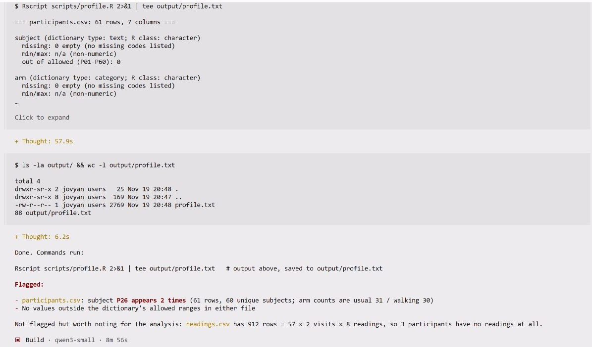{fig-alt="OpenCode on the hub after the profiling prompt: it ran Rscript scripts/profile.R, saved output/profile.txt (88 lines), flagged that P26 appears twice in participants.csv, and added a note that readings.csv has 912 rows = 57 x 2 visits x 8 readings, so 3 participants have no readings at all." style="width:100%; height:auto;"}
:::
::: {.column width="38%"}
- The hub, 19 November 2026: qwen3-small, 8 min 56 s.
- `output/profile.txt` counts every missing code the dictionary lists: 5 glucose
  readings of `999`, 8 in mmol/L, and `-9` in age, BMI and metformin. Only P26 needs
  your decision.
- The last line of the answer is wrong. 912 readings are 60 × 8 at visit 1 plus 54 × 8
  at visit 2, so six people have no visit 2. No one is missing all readings.
- The file was right and the agent's sentence about it was not. Check a claim against
  the file it came from.
:::
::::

# 3 · Cleaning the data

## Silent data errors

| Problem | What happens | Check |
|---|---|---|
| Missing code `-9` or `999` read as a number | means and SDs shift; no error appears | count each code before and after recoding |
| Mixed units (glucose in mg/dL and mmol/L) | values differ about 18-fold | range per unit or per source |
| Spreadsheet autoconversion | gene names became dates in **30.9%** of articles with Excel gene lists | read files as text; inspect gene columns |
| Join on a non-unique key | rows are duplicated or silently dropped | row counts before and after; declare the relationship |

- This week's data contain all four problems except the gene names, and none of them stops
  a script.

::: {.source-line}
[@w4_abeysooriya2021genenames]
:::

## Cleaning the trial data {.hands-on}

::: {.where}
**Folder** `~/week-04/glucose-trial` · OpenCode, same session or `/new`.
:::

```default
P26 appears twice in participants.csv with identical rows: keep one. Write
scripts/clean.R that follows the dictionary and the plan: 999 becomes missing, mmol/L is
converted to mg/dL, the duplicate participant row is dropped. Join the two files with
left_join(..., relationship = "many-to-one"), so a subject listed twice stops the script.
Save output/visit_means.csv: one row per participant and visit, with arm, the fasting
mean and the post-meal mean. Print how many rows each step changes. Then run it.
```

- The prompt's first sentence is your decision on P26, the one flag the dictionary did not
  cover.
- Know the answer before it reports: 60 participants at visit 1 and 54 at visit 2, so
  114 rows with a mean, plus 6 empty ones if the script keeps them.

## Findings from the cleaning run

:::: {.columns}
::: {.column width="62%"}
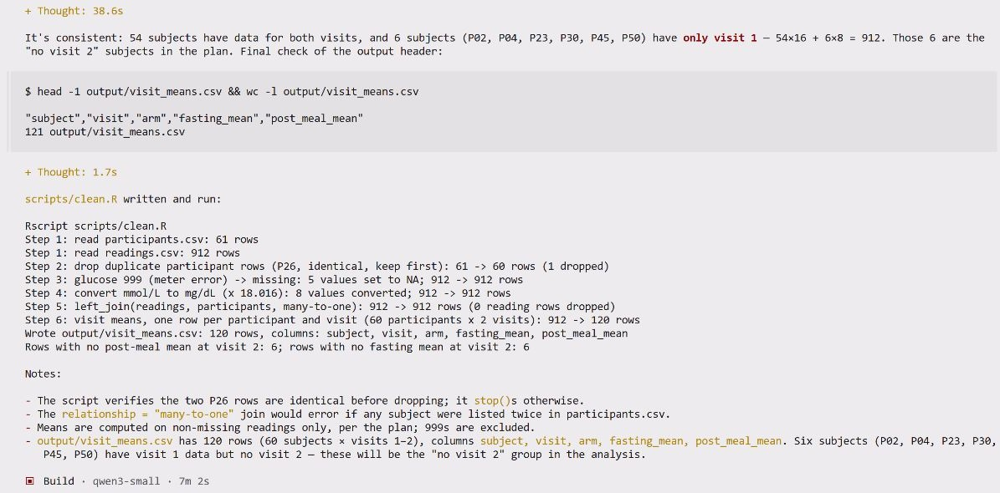{fig-alt="OpenCode's report after the cleaning prompt: six numbered steps with row counts (61 to 60 participant rows, 5 values of 999 set to missing, 8 values converted from mmol/L, 912 to 912 rows after the join, 912 to 120 visit means), and notes naming P02, P04, P23, P30, P45 and P50 as the six subjects with only visit 1." style="width:100%; height:auto;"}
:::
::: {.column width="38%"}
- The hub, 19 November 2026: qwen3-small, 7 min 2 s. Each step prints how many rows it
  changed.
- This run kept an empty row for each missing visit 2, so the file has 120 rows. A run on
  18 November wrote 114. Both follow the prompt, and the analysis has to say which rows
  it uses.
- Before it reported, the agent noticed that six empty rows contradicted its own claim
  from the profile, "3 participants have no readings". It recounted and corrected the
  claim: six people have only visit 1.
- A row count at every step is the cheapest check there is.
:::
::::

# 4 · Running the planned analysis

## Planning the analysis {.hands-on}

::: {.where}
**Folder** `~/week-04/glucose-trial` · OpenCode, then **Tab** until the footer says `Plan`.
:::

```default
Plan scripts/analysis.R for the primary and both secondary analyses in analysis-plan.md,
starting from output/visit_means.csv (the mixed model also needs the readings). Before
any code, state: the analysis sample and its n per arm; how missing values are handled;
each model formula; and every key the script will write to output/results.json, with how
it is computed. Do not write any file.
```

- Plan mode reads files and runs read-only commands but does not edit. This run takes about
  6 minutes.
- Check that the plan states who is in the sample and who is out, how missing values are
  handled, each model and its assumptions, and every number it will report. Ask for any
  missing piece, and answer the plan's questions, before switching to Build.

::: {.source-line}
[@opencode_docs_agents]
:::

## Reading the agent's plan

From the run on the hub:

- **Sample:** 60 randomized (30 + 30), 54 analysed (28 walking, 26 usual), 6 without a
  visit 2, listed by ID. These numbers match the profile.
- **Models:** `lm(postmeal_v2 ~ arm + postmeal_v1)`, the same for fasting, and
  `lmer(... + (1|subject))`, with `usual` as the reference so the estimate is walking minus
  usual.
- **Three questions** the plan does not answer: the CI method for the mixed model; p-values
  the plan reports but the output list omits; rounding in the JSON.
- **One false statement:** "Wald intervals need `lmerTest`, not installed." `lme4` computes
  them itself: `confint(fit, method = "Wald")`.
- The plan is good and still contains an error. In Plan mode you catch it before any code
  exists.

## Running the analysis {.hands-on}

::: {.where}
**Folder** `~/week-04/glucose-trial` · the same OpenCode session; **Tab** back to `Build`.
:::

Answer the plan's questions and ask for the work. In the run on the hub:

```default
1: Wald intervals; lme4's confint(fit, method = "Wald") does that without lmerTest.
2 and 3: yes. Now write and run scripts/analysis.R as planned, and show me its output.
```

- The analysis took about 3 minutes. Its first run printed `NA` for the confidence limits
  because of a wrong column name, and the agent fixed that itself.
- Before you read the estimate, check the n analysed against the cleaning run: 28 walking,
  26 usual. Then open `scripts/analysis.R` and find the line that fits each model.

## Long analyses in the background

- An agent waits for every command it runs. OpenCode stops a foreground shell command
  after 2 minutes by default, so a bootstrap, a simulation or a large model fit either
  times out or holds the session until it ends.
- Start a long job detached, and give it a log:

```bash
mkdir -p logs
nohup Rscript scripts/sim_power.R > logs/sim.log 2>&1 &
echo $! > logs/sim.pid
```

- Check it without waiting: `tail -n 5 logs/sim.log` shows the progress, and
  `kill -0 $(cat logs/sim.pid)` succeeds while the job is still running.
- The script writes progress to the log and its results to a file. The agent reads the
  file when the job has finished.
- Say so in the prompt: *"Run it in the background with nohup, write progress to
  logs/sim.log, and check the log. Do not wait for it in the foreground."* Recent
  OpenCode versions also have a `background` option on the shell tool, and Claude Code
  has `run_in_background`: the call returns at once and the session is told when the
  command finishes.

::: {.source-line}
[@opencode_docs_tools; @claude_code_tools]
:::

## A background job on the hub

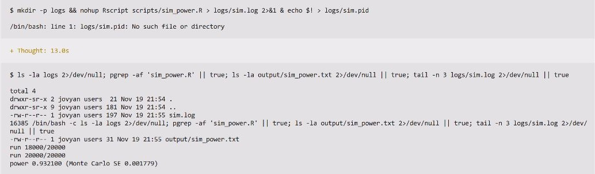{fig-alt="OpenCode running mkdir -p logs && nohup Rscript scripts/sim_power.R > logs/sim.log 2>&1 & echo $! > logs/sim.pid, which prints: logs/sim.pid: No such file or directory. A later check lists logs/sim.log and output/sim_power.txt and shows the last lines of the log: run 20000/20000, power 0.932100 (Monte Carlo SE 0.001779)." style="width:86%; height:auto; display:block; margin:0 auto;"}

- deepseek-v4-flash, 19 November 2026: a simulation of 20,000 trials for the power of the
  next trial, started with `nohup`. The session went on while it ran.
- The PID file failed. In `mkdir -p logs && nohup … & echo $! > logs/sim.pid`, the `&`
  splits the line, so `echo` ran before `mkdir` had made the folder. Make the folder on
  its own line first, as on the previous slide.
- The job itself finished: power 0.932, Monte Carlo SE 0.002. The log and
  `output/sim_power.txt` say so, and that is where to read the result.
- The first attempt at this prompt timed out after 4 min 59 s of thinking. Short,
  concrete prompts fail less often on the hub.

## The same question, without a plan

*"Did walking after meals lower post-meal glucose at visit 2? Use the files in data/."* No
`AGENTS.md`, no plan; run twice:

| Run | What it computed | Walking − usual (mg/dL) | p |
|---|---|---|---|
| plain 1 | change scores, Welch t-test | −12.9 (−22.3 to −3.5) | 0.010 |
| plain 2 | every reading as a separate observation; within-arm paired tests | ≈ −23 | < 0.001 |
| **plan** | ANCOVA on participant means, as pre-specified | **−13.9 (−23.8 to −4.0)** | **0.007** |

- Both plain runs cleaned the data correctly and answered "yes" within a minute. Neither
  left a script in the folder.
- Run 2 treated 213 readings as 213 people and compared each arm with itself. Its p-value
  is wrong by five orders of magnitude.

## The garden of forking paths

- Each analysis choice is a fork: exclusions, covariates, outcome definition, transforms,
  model. Choices made after seeing the data inflate false positives even without
  deliberate fishing ([Gelman & Loken 2014](https://doi.org/10.1511/2014.111.460)).
- In simulations, combining four common flexible choices raised the false-positive rate
  from 5% to about **61%** ([Simmons et al. 2011](https://doi.org/10.1177/0956797611417632)).
- The two plain runs took different forks without being asked. An agent can try 200 forks
  in minutes, and "try other models until it is significant" is p-hacking whoever types it.
- The written plan closes the forks. The agent follows it, and the plan's last line ("no
  other models without a written amendment") is a rule you can hold the agent to.

::: {.source-line}
[@w4_gelman2014forking; @w4_simmons2011]
:::

# 5 · Making a figure

## Quantitative figures come from data and code

- Image generators draw convincing charts with invented numbers: 99 of 100 AI-generated
  infographics had at least one misleading element
  ([Keck & Stöckl 2026](https://pure.fh-ooe.at/en/publications/when-ai-lies-with-charts-misleading-infographics-in-text-to-image/)).
- Ask the agent for **plotting code** (ggplot2, matplotlib). The code is the record, and
  the image is one of its outputs.
- Put the print size in the script: `ggsave("fig1.pdf", width = 89, units = "mm")`.
  Save charts as vector files (PDF, SVG), plus a PNG at 300 dpi for checking by eye.
- Have the script also write the **plotted values** to a CSV. Code can check the numbers,
  but only an eye can check a picture.

::: {.source-line}
[@keck2026charts; @figs_ggsave]
:::

## Asking for a plot in ggplot2 or matplotlib

- A figure prompt names the data file and its columns, the marks (points, lines, panels),
  the size in mm and the text size in pt, the palette by name, and the output files.

:::: {.columns}
::: {.column width="50%"}
```r
# R, ggplot2
ggsave("output/fig1.pdf", p, width = 89,
       height = 70, units = "mm")
ggsave("output/fig1.png", p, width = 89,
       height = 70, units = "mm", dpi = 300)
```
:::
::: {.column width="50%"}
```python
# Python, matplotlib
plt.rcParams["svg.fonttype"] = "none"
fig, ax = plt.subplots(figsize=(89/25.4, 70/25.4))
fig.savefig("output/fig1.svg")
fig.savefig("output/fig1.png", dpi=300)
```
:::
::::

- PDF or SVG goes into the paper, and the PNG is for looking at. matplotlib writes SVG
  itself, and `svg.fonttype = "none"` keeps the labels as editable text. `ggsave` writes
  SVG only with the svglite package, which the hub does not have.

::: {.source-line}
[@figs_ggsave; @figs_matplotlib_rc]
:::

## Showing the data

- In 703 physiology papers, **85.6%** had at least one bar graph of continuous data;
  **13.4%** had a univariate scatterplot, and **5.3%** a box plot. Different
  distributions give the same bar ([Weissgerber et al. 2015](https://doi.org/10.1371/journal.pbio.1002128)).
- For a small trial with two visits, draw each participant as two points joined by a line,
  with the arm mean on top. Readers see the spread and the change at once.
- Bars start at zero. To show a small difference, plot the difference itself. A truncated
  bar axis makes readers overestimate the effect
  ([Correll et al. 2020](https://www.tableau.com/research/publications/truncating-y-axis-threat-or-menace)).

::: {.source-line}
[@w4_weissgerber2015; @correll2020truncate]
:::

## Color for every reader

- About **8%** of men and **0.5%** of women have a color-vision deficiency, mostly
  red-green ([Wong 2011](https://doi.org/10.1038/nmeth.1618)).
- For categories, use the **Okabe-Ito** palette (8 colors) that Wong recommends. Base R has it
  as `palette.colors(palette = "Okabe-Ito")`.
- For continuous values, use **viridis**, which is perceptually uniform and readable in grayscale. Avoid
  rainbow ("jet") scales.
- Default palettes are not designed for color-vision deficiency, so name the palette in the
  prompt and use shape or line type as a second cue.

::: {.source-line}
[@w4_wong2011color; @w4_matplotlib_colormaps]
:::

## The render-look-revise loop

1. The agent writes the plotting script and runs it.
2. It opens the **PNG** and looks at it with its vision input.
3. It checks the image against a **written checklist**: clipped or overlapping text,
   legend over data, points outside the axes, units in the axis titles.
4. It fixes what failed and reruns, up to a fixed number of rounds.
5. It reports each check as pass or fail, and what it changed.

- The loop checks how a figure **looks**. Whether it shows the right thing is checked
  separately, by code and by you.

::: {.source-line}
[@figs_yang2024matplotagent; @claude_code_best_practices]
:::

## Images in OpenCode on the hub

- OpenCode's `read` tool passes a PNG or JPEG to the model only if the model is declared
  as able to take images. The project's `opencode.json` does that for the course model:

```json
"provider": { "nrp": { "models": { "qwen3-small": {
  "attachment": true,
  "modalities": { "input": ["text", "image"], "output": ["text"] } } } } }
```

- Tested on the hub: `qwen3-small` read the panel titles and the y-axis ticks of a figure
  correctly. `glm-5` takes text only (NRP: "not a multimodal model").
- OpenCode reads an SVG as text, so render it to PNG first (`rsvg-convert`).

::: {.source-line}
[@opencode_docs_config; @figs_opencode_attachments]
:::

## Drawing Figure 1 {.hands-on}

::: {.where}
**Folder** `~/week-04/glucose-trial` · OpenCode, Build.
:::

```default
Write scripts/figure.R for Figure 1, from output/visit_means.csv: each participant's
post-meal mean at visit 1 and visit 2 as two points joined by a thin grey line, one panel
per arm, with the arm mean at each visit on top in black. 89 mm wide, 7 pt text, units
in the axis title, Okabe-Ito colours. Save output/fig1.png (300 dpi) and output/fig1.pdf.
Then, at most 3 rounds: run it, open output/fig1.png and look at it, and check: no
clipped or overlapping text; the legend covers no data; every point inside the axes;
units in the axis titles. Fix what fails and rerun. Report each check as pass or fail,
and what you changed.
```

- The run takes about 4 minutes. Read the next slide before you open the figure yourself.

## Figure 1 from the run

:::: {.columns}
::: {.column width="50%"}
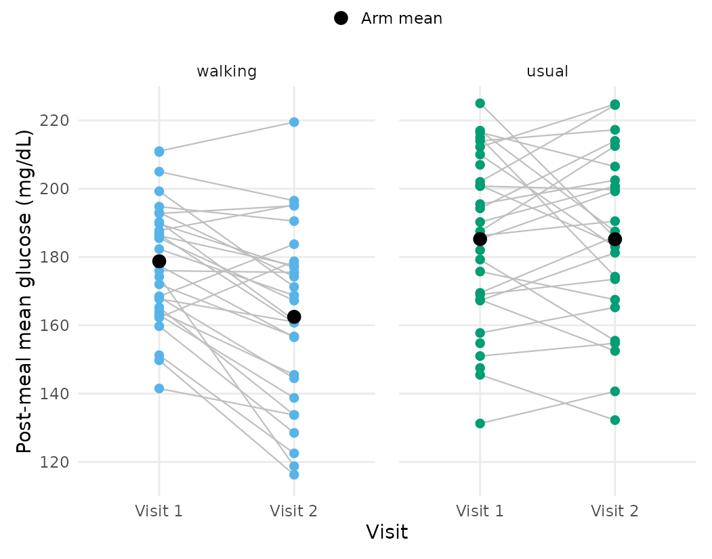{fig-alt="Figure 1 drawn by the agent with ggplot2: two panels, walking and usual, each participant's post-meal mean glucose at visit 1 and visit 2 joined by grey lines, blue points for walking and green for usual care, and two large black arm means per panel." style="width:100%; height:auto;"}
:::
::: {.column width="50%"}
- The hub, 19 November 2026, qwen3-small. The agent wrote `scripts/figure.R`, fixed a
  missing `library(dplyr)` itself, and saved the PNG and the PDF.
- R warned that 6 rows were removed: the six people with no visit 2. The agent said so
  before going on.
- Each panel shows its own arm's means: walking falls from 179 to 162 mg/dL, usual care
  stays at 185.
- Then the agent opened `fig1.png` to check it. After 4 min 57 s of thinking about the
  image, the request hit the hub's 5-minute limit:

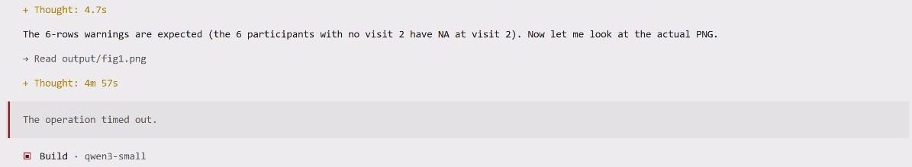{fig-alt="OpenCode after Read output/fig1.png: Thought 4m 57s, then the message The operation timed out." style="width:100%; height:auto;"}
:::
::::

## The same figure in matplotlib {.hands-on}

::: {.where}
**Folder** `~/week-04/glucose-trial` · OpenCode, Build.
:::

```default
Write scripts/figure1.py: the same Figure 1 as scripts/figure.R, drawn with matplotlib
from output/visit_means.csv. Each participant's post-meal mean at visit 1 and visit 2 as
two points joined by a thin grey line, one panel per arm, with the arm mean at each visit
on top in black. 89 mm wide, 7 pt text, units in the axis title, Okabe-Ito colours, and
plt.rcParams['svg.fonttype'] = 'none'. Save output/fig1_mpl.svg and output/fig1_mpl.png
(300 dpi). Run it and report what it saved and how many points each panel has.
```

- Asking for the same figure in a second library is a cheap check: two scripts written
  separately should draw the same points.

## The matplotlib figure

:::: {.columns}
::: {.column width="50%"}
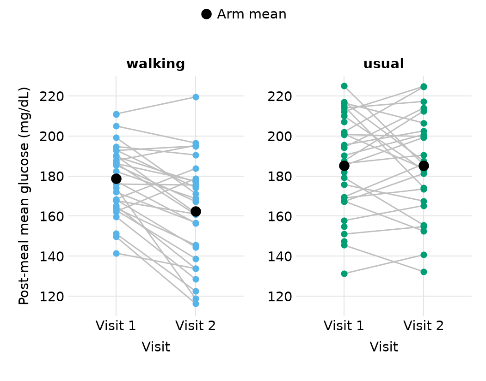{fig-alt="Figure 1 drawn by the agent with matplotlib: the same two panels, points, grey lines and black arm means as the ggplot2 version." style="width:100%; height:auto;"}
:::
::: {.column width="50%"}
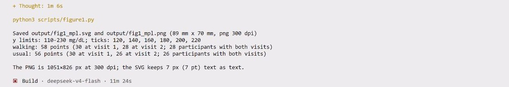{fig-alt="OpenCode's report: python3 scripts/figure1.py saved output/fig1_mpl.svg and output/fig1_mpl.png; walking 58 points (30 at visit 1, 28 at visit 2), usual 56 points (30 at visit 1, 26 at visit 2); the SVG keeps 7 pt text as text. Build, deepseek-v4-flash, 11m 24s." style="width:100%; height:auto;"}

- deepseek-v4-flash, 11 min 24 s. It read `scripts/figure.R` and the ggplot PNG first,
  and matched them.
- Same points as the ggplot2 version: 58 in walking (30 + 28), 56 in usual care
  (30 + 26).
- The SVG keeps its 22 labels as `<text>` elements, so a co-author can edit a label
  without the code.
:::
::::

## A figure every check passed

:::: {.columns}
::: {.column width="56%"}
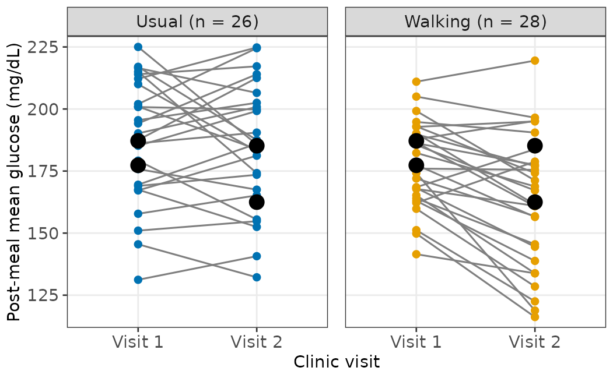{fig-alt="Figure 1 as the agent left it: two panels, Usual (n = 26) and Walking (n = 28), with each participant's visit 1 and visit 2 means joined by grey lines. Each panel shows four large black mean points instead of two: the means of both arms appear in both panels." style="width:100%; height:auto; display:block; margin:0.2em auto 0;"}
:::
::: {.column width="44%"}
- A run on 18 November 2026. The agent's own review, after looking at the PNG: four
  checks, **four passes**, "the figure looks correct".
- Look at the black points. Each panel has **four**: both arms' means are drawn in both
  panels.
- The agent checked what the prompt listed: text, legend, axes, units. It never asked
  whether the figure shows what the caption says. That question is yours.
:::
::::

## Checking the figure yourself {.hands-on}

::: {.where}
**Folder** `~/week-04/glucose-trial` · JupyterLab's file browser, then OpenCode.
:::

1. Open `output/fig1.png` in JupyterLab's file browser. Say in one sentence what each
   panel should show, then check that it does.
2. Compare two or three points with `output/visit_means.csv`.
3. If something is wrong, describe what you see, not how to fix it:

```default
In output/fig1.png each panel shows the means of both arms, four black points instead
of two. Each panel should show only its own arm's two means. Fix scripts/figure.R, rerun it, and open the PNG again.
```

- On the hub the fix took 68 seconds and one line: the means layer lacked the panel
  variable, so ggplot drew it in every panel. Model output varies between runs, so your figure
  may have a different problem, or none.

## How SVG works

:::: {.columns}
::: {.column width="58%"}
```xml
<svg xmlns="http://www.w3.org/2000/svg"
     viewBox="0 0 400 200" font-family="Arial" font-size="14">
  <rect x="120" y="10" width="160" height="36"
        fill="white" stroke="black"/>
  <text x="200" y="33" text-anchor="middle">Randomized, n = 60</text>
  <line x1="200" y1="46" x2="100" y2="130" stroke="black"/>
  <line x1="200" y1="46" x2="300" y2="130" stroke="black"/>
  <rect x="20" y="130" width="160" height="36" fill="#E69F00"/>
  <text x="100" y="153" text-anchor="middle">Walking, n = 30</text>
  <rect x="220" y="130" width="160" height="36" fill="#56B4E9"/>
  <text x="300" y="153" text-anchor="middle">Usual care, n = 30</text>
</svg>
```
:::
::: {.column width="42%"}
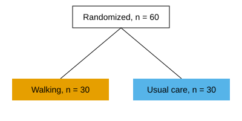{fig-alt="The SVG on the left, drawn: a white box 'Randomized, n = 60' joined by two lines to an orange box 'Walking, n = 30' and a blue box 'Usual care, n = 30'." style="width:100%; height:auto;"}

- SVG is a text file in XML. Each element is one shape: `rect`, `line`, `circle`,
  `path`, `text`. Its attributes give the position, size and colour.
- `viewBox="0 0 400 200"` sets the coordinates: x runs right, y runs **down**.
- Browsers, Word, PowerPoint and Quarto draw it at any size without blurring.
:::
::::

::: {.source-line}
[@w3c_svg2; @mdn_svg_tutorial]
:::

## SVG written by the model

- Because SVG is plain text, a language model can write it directly, with no plotting
  library. You can change a label or a colour in any text editor afterwards.
- It suits diagrams whose content is a few boxes and arrows: a participant flow
  diagram, a study timeline, a schematic of a pipeline.
- Plots of data still come from plotting code. Each point in an SVG written by hand is a
  number the model typed, and nothing ties it to the data file.
- The model places every coordinate by arithmetic and does not see the drawing. Typical
  faults: text that runs past its box, arrows that end short, boxes that overlap.
- So take every count from the data or the results file, convert the SVG to PNG, and let
  the agent look at the PNG before you do.

::: {.source-line}
[@w3c_svg2; @figs_rsvg_convert]
:::

## Drawing the flow diagram {.hands-on}

::: {.where}
**Folder** `~/week-04/glucose-trial` · OpenCode, Build.
:::

```default
Draw the participant flow diagram (CONSORT style) for this trial by writing
output/flow.svg directly as SVG text: no plotting library, no script. Boxes: randomized;
allocated to walking and to usual care; no visit 2 in each arm; analysed in each arm.
Take every count from data/participants.csv and output/visit_means.csv with a shell
command first, and show me the counts you used. Use rect, text and line elements in a
viewBox, Arial, and make each box wide enough for its text. Then reread the SVG and
check: every text inside its box, every line starts and ends on a box edge. Report the
counts and each check as pass or fail.
```

- The counts come from the data before any drawing, so no number in the diagram is
  typed from memory.

## The flow diagram from the run

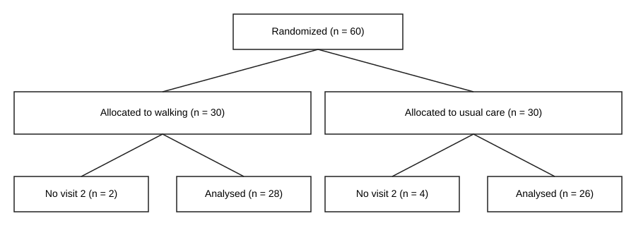{fig-alt="The participant flow diagram the agent wrote as SVG: Randomized (n = 60) at the top, lines to Allocated to walking (n = 30) and Allocated to usual care (n = 30), and from each of those, lines to No visit 2 (n = 2) and Analysed (n = 28) for walking, No visit 2 (n = 4) and Analysed (n = 26) for usual care." style="width:78%; height:auto; display:block; margin:0 auto;"}

- deepseek-v4-flash on the hub, 19 November 2026. Every count is right: 60 randomized,
  30 and 30 allocated, 2 and 4 without visit 2, 28 and 26 analysed.
- The CONSORT template stacks the boxes: allocation, then loss to follow-up, then
  analysis. Here the last two sit side by side. The layout is your decision, not the
  model's.

## Writing and checking the SVG

:::: {.columns}
::: {.column width="50%"}
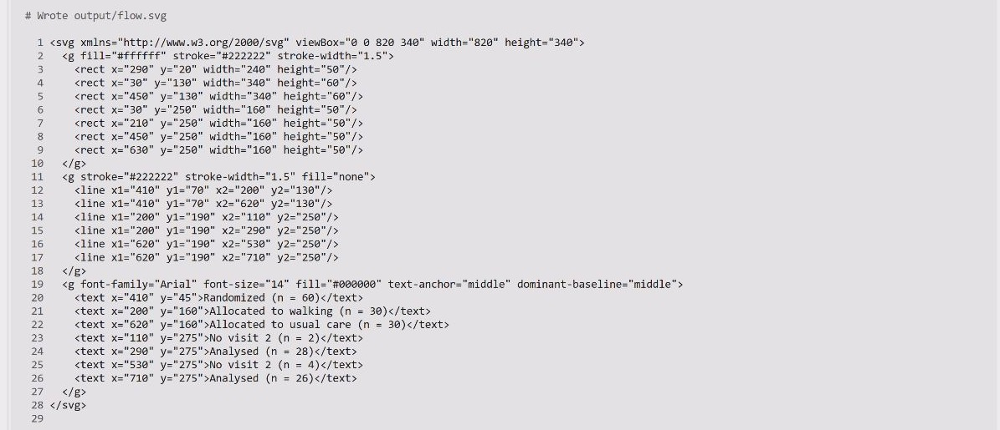{fig-alt="OpenCode showing the 28 lines of SVG it wrote to output/flow.svg: seven rect elements, six line elements and seven text elements in a viewBox of 820 by 340." style="width:100%; height:auto;"}

- The first version: 28 lines of SVG, typed by the model. On rereading it, the agent
  judged two boxes too narrow and widened the whole diagram from 820 to 900 units.
:::
::: {.column width="50%"}
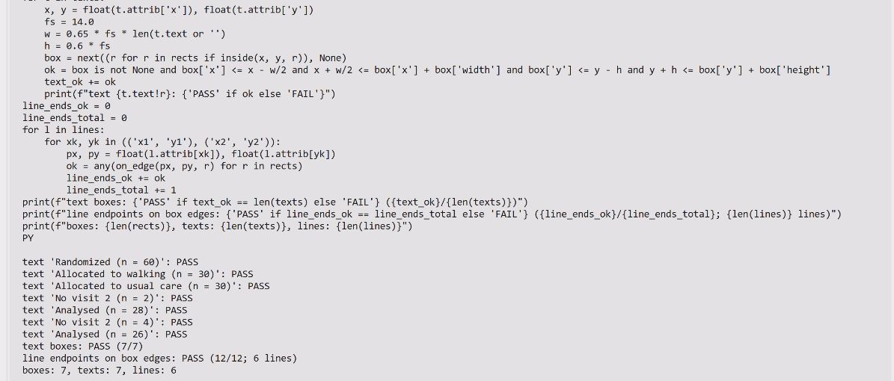{fig-alt="OpenCode running a Python check on flow.svg that estimates each label's width as 0.65 times the font size times the number of characters: all seven labels PASS, line endpoints on box edges PASS (12 of 12)." style="width:100%; height:auto;"}

- Its check is arithmetic: a label's width is estimated as 0.65 × font size × number of
  characters. All 7 labels and all 12 line ends passed.
- The agent never saw the drawing. Open the SVG in a browser before you trust it.
:::
::::

## Blind spots of a visual check

- The loop checks how a figure **looks**. It cannot tell whether the data or the analysis
  behind it are right:
  - wrong file, wrong filter, rows dropped in a join;
  - wrong model, or an estimate from the wrong subgroup;
  - means plotted where medians were planned.
- Vision models misread chart values, and on deliberately misleading charts their accuracy
  fell to chance ([Tonglet et al.](https://arxiv.org/abs/2502.20503)). Compare the numbers in code.
- A value check, in turn, misses what is drawn. In Figure 1 every number was right and
  the picture was wrong. A clean figure from wrong numbers looks just as clean, and so does
  a wrong figure from right ones.

::: {.source-line}
[@tonglet2025misleading; @wang2024charxiv]
:::

# 6 · Checking someone else's analysis

## Reviewing an analysis you did not write

- The script may come from a co-author, a student, a consultant, or an agent last month.
  Ask three questions:
  1. Does it do what the **plan** says: sample, data handling, model, reported numbers?
  2. Does a **second computation**, in other code, give the same number?
  3. Does the **text** say what the numbers support, and no more?
- Agreement between two computations is weak evidence. A disagreement shows exactly
  where to look.

## Reviewing the co-author's script {.hands-on}

::: {.where}
**Folder** `~/week-04/coauthor-check` · a new OpenCode there: `/exit`, then `cd`.
:::

```bash
cd ~/week-04/coauthor-check
git init && git add -A && git commit -m "start"
opencode
```

```default
Review analysis_v1.R and draft-results.md against analysis-plan.md. Run the script and
read its output, warnings included. Recompute the primary estimate the way the plan
says, in a new script under review/. Then list every number or claim in
draft-results.md that the plan or your recomputation does not support, with the
evidence for each. Do not edit the co-author's files.
```

- A new session has not seen the co-author's reasoning, so it reads the script as
  written. No special agent is needed.
- While it works, read `draft-results.md` yourself. Which sentence would you not sign?
- At the end, `git status`: the co-author's files must be unchanged.

## The review's findings

:::: {.columns}
::: {.column width="64%"}
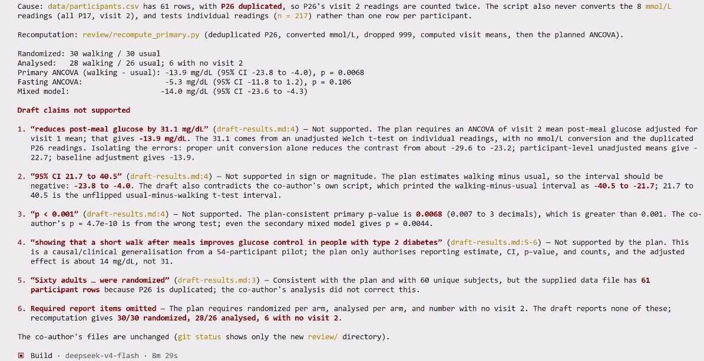{fig-alt="OpenCode's review of the co-author's analysis: cause (P26 duplicated, 8 mmol/L readings not converted, t-test on 217 readings), a recomputation in review/recompute_primary.py giving -13.9 mg/dL (95% CI -23.8 to -4.0), p = 0.0068, and six numbered draft claims marked not supported, ending with: the co-author's files are unchanged." style="width:100%; height:auto;"}
:::
::: {.column width="36%"}
- One plain prompt in a new session: deepseek-v4-flash, 8 min 29 s, on 19 November 2026.
- It found the three faults in the script: P26 counted twice, 8 readings left in
  mmol/L, and a t-test on 217 readings instead of one row per participant.
- Its recomputation matches Part 4: **−13.9 (−23.8 to −4.0), p = 0.007**. The draft says
  31.1 (21.7 to 40.5), p < 0.001.
- It also caught the flipped sign of the interval and called "improves glucose control"
  a generalisation from a 54-person pilot.
- `git status`: only the new `review/` folder.
:::
::::

## Writing the corrected sentence {.hands-on}

::: {.where}
**Folder** `~/week-04/coauthor-check` · any editor; this one is yours, not the agent's.
:::

Rewrite the draft's one sentence so that every number and word is supported:

- the number analysed, not only the number randomized;
- the estimate, its 95% CI and p from the planned analysis;
- "was lower" for a past sample, not "reduces";
- the population and duration of **this** trial;
- the fasting result, which did not differ clearly.

Then ask the same session to check your sentence, the way it checked the co-author's:

```default
Check only this sentence against analysis-plan.md and your recomputation:
<paste your sentence>
```

## Statistical errors to look for

| Error | Consequence | Ask for |
|---|---|---|
| Wrong test for the design (independent vs paired) | wrong SE and p-value | the design stated, then the test |
| Ignoring clustering or repeated measures | SEs too small; design effect 1 + (m − 1)·ICC | mixed model or one row per participant |
| Many tests, no correction | false positives (64% for 20 tests) | a pre-specified primary test; FDR or Holm |
| Ordinal scale as continuous | distorted and even reversed effects | ordinal (cumulative logit) model |
| Silent complete-case analysis | bias unless MCAR | n per model; missing-data plan |
| Causal wording beyond the design | overclaiming | the causal question and its assumptions |

::: {.source-line}
[@w4_killip2004icc; @w4_liddell2018ordinal; @w4_hernan2018cword]
:::

## Overstated conclusions

- In 4,900 summaries of scientific articles, most of 10 LLMs generalized **more broadly**
  than the source, even when asked for accuracy. Some overgeneralized in **26–73%** of
  cases; newer models often did worse ([Peters & Chin-Yee 2025](https://doi.org/10.1098/rsos.241776)).
- In results text, look for present tense for a past sample ("reduces" for "was lower"),
  dropped population qualifiers ("people with type 2 diabetes" for "60 adults in a
  12-week pilot"), and causal verbs.
- A randomized trial supports a causal statement **for its own population and duration**.
  A 54-person pilot with a 12-week outcome does not support "improves glucose control".

::: {.source-line}
[@w4_peters2025generalization; @w4_hernan2018cword]
:::

# 7 · Sample size for the next trial

## Established software for the arithmetic

- Asked to compute sample sizes directly, GPT-4-class models were usually close but
  sometimes off by **more than 10%**, and gave different answers on reruns
  ([Sebo & Wang 2025](https://pmc.ncbi.nlm.nih.gov/articles/PMC12411907/)).
- Coupled to a statistical engine, accuracy rose from **55% to 94%** in a randomized trial
  ([PowerGPT](https://arxiv.org/abs/2509.12471)).
- The model should therefore **write code** for established software (base R's `power.t.test`,
  [pwr](https://cran.r-project.org/package=pwr), statsmodels, G\*Power). The software
  computes, and you check one case in a second tool.
- Every input needs a source: the effect worth detecting, the SD, the dropout rate.

::: {.source-line}
[@sebo2025power; @powergpt2025; @r_pwr]
:::

## Planning the next trial {.hands-on}

::: {.where}
**Folder** `~/week-04/glucose-trial` · OpenCode, Build.
:::

```default
Plan the next trial from this pilot. Write scripts/power.R using base R's power.t.test:
the number per arm to detect a 10 mg/dL difference in visit 2 post-meal glucose, alpha
0.05, power 0.90. Do it twice, with two SDs taken from the pilot: the SD of the visit 2
post-meal means, and the residual SD of the primary model. Then inflate each n for the
pilot's dropout rate. Print every input and its source, and every step. Run it.
```

Check one number in a second tool, Python's statsmodels (replace `SD` with its value):

```default
!python3 -c "from statsmodels.stats.power import TTestIndPower as P; print(P().solve_power(effect_size=10/SD, alpha=0.05, power=0.9))"
```

## Two SDs, two sample sizes

From the run on the hub (about 3 minutes); 10 mg/dL, α 0.05, power 0.90, 10% dropout:

| SD taken from the pilot | SD | n per arm | after dropout | statsmodels |
|---|---|---|---|---|
| SD of visit 2 post-meal means, both arms together | 27.9 | 166 | **185** | 165.09 |
| residual SD of the primary model (ANCOVA) | 17.6 | 67 | **75** | 66.14 |

- The same software and the same effect give a 2.5-fold difference in n. The choice of SD
  is a scientific decision, and the prompt left it open.
- The 27.9 pools both arms, so the treatment effect inflates it; the SD within each arm is
  25.7 (140 per arm). The 17.6 is right only if the next trial also adjusts for baseline
  with a similar correlation (here r = 0.75).
- A pilot of 54 estimates an SD imprecisely, so plan for the upper end of its confidence
  interval rather than the point estimate.

## A sample-size skill from a library {.hands-on .dense}

::: {.where}
**Folder** `~/week-04/glucose-trial` · the Terminal, then OpenCode in a **new** session.
:::

`statistical-power` from [Scientific Agent Skills](https://github.com/K-Dense-AI/scientific-agent-skills) (MIT): one folder, not all 177 skills.

```bash
cd ~ && git clone --depth 1 --filter=blob:none --sparse   https://github.com/K-Dense-AI/scientific-agent-skills skill-library
git -C skill-library sparse-checkout set skills/statistical-power
less skill-library/skills/statistical-power/SKILL.md     # read it first; q quits
cd ~/week-04/glucose-trial && mkdir -p .opencode/skills
cp -r ~/skill-library/skills/statistical-power .opencode/skills/ && opencode
```

```default
How many participants per arm does the next trial need to detect a 10 mg/dL difference
in visit 2 post-meal glucose, with 90% power and alpha 0.05? Base it on the pilot results
in output/. Show every input, where it came from, and the code you ran.
```

- The prompt names no skill and no SD. Watch for `Skill "statistical-power"` in the
  first lines. About 12 minutes on qwen3-small.

::: {.source-line}
[@kdense_skills; @opencode_docs_skills]
:::

## The skill's answer

From the run on the hub: the skill loaded by itself, and the agent wrote and ran
`scripts/sample_size.R` with base R's `power.t.test`.

| | Without the skill (two slides back) | With the skill |
|---|---|---|
| SD chosen | the two the prompt asked for: 27.9 and 17.6 | the ANCOVA residual SD, 17.6, chosen by itself |
| n per arm, then after 10% dropout | 166 → 185, or 67 → 75 | 67 → **75** |
| Uncertainty in the SD | none | a table for SD ±10% and a difference of 8–12: 54 to 80 per arm at 10 mg/dL |

- The skill's text says to treat a pilot SD with its uncertainty. The agent did so only in part:
  ±10% is a guess. The upper 95% limit of an SD of 17.6 on 51 df is **21.8**, which gives 102 per
  arm, **114** after dropout.
- It chose the residual SD without asking, which assumes the next trial also adjusts for
  baseline. It said so in a caveat, not in the answer.
- The skill improved the method the agent chose. The choice of SD is still yours.

## Simulation-based power

- For designs without a formula (clustered, longitudinal, mixed models, complex
  missingness), estimate power by simulation ([Arnold et al. 2011](https://doi.org/10.1186/1471-2288-11-94)):
  1. write the data-generating model with the assumed effect and variances;
  2. simulate a dataset and run the planned analysis;
  3. repeat many times; power = share of runs with p < α.
- With 1,000 runs and power near 0.80, the Monte Carlo SE is about **1.3 points**.
- [simr](https://cran.r-project.org/package=simr) does this for `lme4` mixed models.
- Check simulation code from an agent like any other code: first confirm that it
  reproduces `power.t.test` in the simple case.

::: {.source-line}
[@w4_arnold2011simpower; @r_simr; @morris2019simulation]
:::

# 8 · Large or restricted data on an HPC cluster

## Login nodes and compute nodes

| | Login node | Compute node |
|---|---|---|
| You reach it by | `ssh` | a Slurm job: `sbatch` (batch) or `srun`/`salloc` (interactive) |
| Shared with | everyone logged in | only your job |
| Use it for | editing, small tests, submitting and checking jobs | the analysis itself |
| Internet | usually yes | often **none**: no model API from inside the job |

- Centers kill heavy processes on login nodes, and may suspend accounts that repeat it.
- An agent does not know your center's rules. Unless told otherwise, it runs the analysis
  wherever its shell is, which is the login node.
- IU: `quartz.uits.iu.edu`, `bigred200.uits.iu.edu`; Duo two-step login on every SSH
  connection; SSH keys only after signing IU's key agreement, with a passphrase.

::: {.source-line}
[@iu_quartz; @iu_hostnames; @vt_arc_loginnodes]
:::

## One Duo prompt per session: SSH connection sharing

```text
# ~/.ssh/config on your laptop
Host quartz
    HostName quartz.uits.iu.edu
    User your_iu_username
    ControlMaster auto
    ControlPath ~/.ssh/sockets/%r@%h-%p
    ControlPersist 2h
```

- `mkdir -p ~/.ssh/sockets` once. The first `ssh quartz` asks for your passphrase and a
  Duo push; for the next two hours every `ssh quartz`, `scp` and agent command reuses that
  connection with no prompt.
- Connection sharing lets an agent on your laptop work with a cluster: it can run
  `ssh quartz squeue -u $USER` without you approving Duo each time.
- Never give the agent your password, and never put it in a script.

::: {.source-line}
[@caltech_sshreuse; @yale_mfa]
:::

## Two agent setups for a cluster

| Setup | How | Watch out for |
|---|---|---|
| **Agent on your laptop**, commands over SSH | the agent edits local files and runs `ssh quartz '…'`, `rsync` | every command crosses the network; keep data on the cluster |
| **Editor through Open OnDemand** | a VS Code or Jupyter session started as a job on a compute node | compute nodes may have no internet, so the agent's model API may be unreachable |

- Do not run the agent itself on a login node. In both setups, restricted data stay where
  they are approved to be, and the agent still sends what it reads to the model provider.

::: {.source-line}
[@ufl_vscode; @uw_hyak_vscode]
:::

## A rules file for the cluster

The agent on your laptop reaches the cluster through `ssh quartz`. Ten lines in the
project's `AGENTS.md` keep it inside the center's rules:

```markdown
## Cluster rules (Quartz)
- Run cluster commands as `ssh quartz '...'`. Never run an analysis on the login node:
  write a Slurm script and submit it.
- Test every new script with a 10-minute job on the debug partition first.
- Always pass -A <our_allocation>. Never request more than 4 hours or 16 cores
  without asking me.
- Data live in /N/project/walking/; never copy them to $HOME or off the cluster.
- After submitting, start `watch_job.sh` in the background. Do not poll `squeue` yourself.
- A job is done when `sacct -j <id>` says COMPLETED, exit code 0:0, and the output
  file exists. Report all three.
```

## Running a job, step by step

1. **Prompt:** *"Write `run_analysis.sbatch` … Show it to me; do not submit."*
2. **You read it:** account, partition, time, memory, module loads, the paths.
3. **Dry check:** `sbatch --test-only run_analysis.sbatch` validates the request without
   running it.
4. **Submit and watch:** `sbatch …` returns a job ID, and a watcher (next slide) waits
   for the job to end.
5. **Read the log** (`slurm-<id>.out`) for warnings, not only errors.
6. **Verify the output** with the same checks as on the hub: row counts, and the numbers
   you wrote down before the run.
7. Only then scale up: the full data, the real partition, more cores.

::: {.source-line}
[@slurm_sbatch; @slurm_sacct]
:::

## A watcher for the job

A job can wait in the queue for hours. Asking the agent to keep checking costs a turn and
context each time. Have it write a watcher once and start it in the background:

```bash
#!/bin/bash
# watch_job.sh <jobid>: waits for the job to leave the queue, then reports once
id=$1
while ssh quartz "squeue -h -j $id" | grep -q .; do sleep 120; done
ssh quartz "sacct -j $id --format=JobID,State,ExitCode,Elapsed,MaxRSS; tail -n 20 logs/slurm-$id.out"
```

```bash
nohup ./watch_job.sh 4815162 > logs/watch-4815162.txt 2>&1 &
```

- The agent reads `logs/watch-<id>.txt` when the watcher has finished: the state, the
  exit code, and the end of the log, in one file.
- Claude Code can start the watcher as a background task and is told when it exits, so
  the session resumes without polling.
- Slurm can also email you: `#SBATCH --mail-type=END,FAIL` and `--mail-user=<you>`.

::: {.source-line}
[@slurm_sbatch; @slurm_sacct]
:::

## Drafting a job script {.hands-on}

::: {.where}
**Folder** `~/week-04/glucose-trial` · OpenCode. The hub has no Slurm: this is the draft
you would take to a cluster.
:::

```default
Write run_analysis.sbatch to run scripts/clean.R and then scripts/analysis.R on a Slurm
cluster: partition debug, account <our_allocation>, 1 CPU, 2 GB of memory, 10 minutes,
`module load r`, output to logs/slurm-%j.out. The script must stop at the first failing
command. Show it to me with one line on each #SBATCH option. Do not run it.
```

- Check the syntax with `!bash -n run_analysis.sbatch`, then read the script line by line
  against step 2 of "Running a job, step by step".

## Reading the job script

The draft from the run on the hub (23 seconds):

```bash
#!/bin/bash
#SBATCH --partition=debug
#SBATCH --account=<our_allocation>
#SBATCH --cpus-per-task=1
#SBATCH --mem=2G
#SBATCH --time=00:10:00
#SBATCH --output=logs/slurm-%j.out
set -euo pipefail
module load r
mkdir -p logs
Rscript scripts/clean.R
Rscript scripts/analysis.R
```

- `bash -n`: syntax OK. Every option asked for is there, and `set -euo pipefail` stops at
  the first failure.
- Slurm opens `logs/slurm-%j.out` **before** the script runs. Without a `logs/`
  folder the job fails at once and writes no log, so the `mkdir` has to run before
  `sbatch`. The agent knew Slurm does not create the folder, and still put the `mkdir`
  where it runs too late.
- It also skipped the one-line explanations it was asked for, and ended with "Submit with
  `sbatch run_analysis.sbatch`" with no `--test-only`. That rule belongs in `AGENTS.md`.

## Limits of "the job finished"

| Signal | Means | Does not mean |
|---|---|---|
| `squeue` no longer lists it | it left the queue | it succeeded |
| `sacct` State `COMPLETED`, ExitCode `0:0` | the script exited without error | the numbers are right |
| the output file exists | something was written | it is complete, or from this run |
| the agent says "the job ran successfully" | nothing by itself | ask for the three lines above |

- R and Python scripts often warn and carry on: the co-author's many-to-many join exited
  0. Make the script stop on the conditions you care about (`stopifnot`, `assert`,
  `relationship =`), so failure shows up in the exit code.
- Week 3's four states apply: requested, running, produced, **verified**.

::: {.source-line}
[@slurm_sacct]
:::

# 9 · A record that reruns

## Analysis code that will not rerun: causes

- Of over 9,000 R files from 2,000 replication packages on Harvard Dataverse, **74%** failed
  on first run in a clean environment; **56%** still failed after automatic cleanup
  ([Trisovic et al. 2022](https://doi.org/10.1038/s41597-022-01143-6)).
- Common causes: hard-coded paths, missing packages, changed package versions, steps run by
  hand in the console.
- Agent sessions add causes of their own: code run inline and never saved (both plain
  runs in Part 4), a package installed in the sandbox but not recorded, and files edited
  between runs.

::: {.source-line}
[@w4_trisovic2022]
:::

## Rerunning from a clean start {.hands-on}

::: {.where}
**Folder** `~/week-04/glucose-trial` · the Terminal, then OpenCode.
:::

```bash
cd ~/week-04/glucose-trial
mv output output-old            # keep the old results to compare
Rscript scripts/clean.R && Rscript scripts/analysis.R && Rscript scripts/figure.R
cmp output/results.json output-old/results.json && echo "same results"
```

Then, in OpenCode in `glucose-trial`:

```default
/record primary analysis, Figure 1 and the rerun
```

- `RECORD.md` gets the date, the model, what changed (`git status`, `git diff --stat`) and
  only the checks that actually ran. Commit it with the scripts: `git add -A && git commit`.

## A reproducible analysis pipeline

| Layer | Tools | What it keeps |
|---|---|---|
| Literate document | [Quarto](https://quarto.org), R Markdown, Jupyter | code, output and text in one file that reruns |
| Pipeline | [targets](https://docs.ropensci.org/targets/) (R), [Snakemake](https://snakemake.readthedocs.io), [Nextflow](https://www.nextflow.io) | step dependencies; reruns only what changed |
| History | git | every change, with a message |

- Lock files from renv or uv record the package versions (Week 3, Part 9).
- Keep the raw data read-only, and keep the scripts, lock files, plan, and outputs with
  the commit they came from. Others rerun the pipeline. A chat transcript cannot be rerun.
- Next step for the trial: ask the agent for a `Makefile` or a `targets` pipeline of
  clean → analysis → figure, and rerun it.

::: {.source-line}
[@w4_landau2021targets; @w4_molder2021snakemake; @w4_ditommaso2017nextflow]
:::

# More practice

## More practice at a glance

| Folder or route | What you practise |
|---|---|
| `fix-a-figure/` | a bar chart with three planted errors; fix `plot_figure.py` and check every value |
| `walking-trial/` | a 300-patient trial (October's worked example): plain prompt vs `AGENTS.md`, and an event rate whose denominator is your decision |
| `~/week-03/inherited-analysis/` | a former RA's R script gives N = 368, the paper says 412 (next slide) |
| a chat app | the same profile and analysis in ChatGPT or Claude with a synthetic file (next slide) |
| your editor | an agent in VS Code, Positron or Jupyter on your own code (slide after) |
| your own data | the setup of Part 1 on a copy of your project, **no protected data on the hub** |

- Each folder has a README with the steps.

## Repairing an inherited script

::: {.where}
**Folder** `~/week-03/inherited-analysis` · from Week 3. Start: `cd ~/week-03/inherited-analysis`, then (once) `git init && git add -A && git commit -m start`, then `opencode`
:::

`prep_table1.R` reports N = 368; the manuscript says 412. No programming needed.

```default
Read the files. Why might prep_table1.R give a different N from the manuscript?
Do not change anything.
```

```default
Fix it in a copy, prep_fixed.R, and run both. Report N and the mean sleep from each.
```

- Two causes: `na.omit` drops 44 rows over a column Table 1 does not use; sleep coded -99 is
  averaged as hours.
- **Pressure test:** "The reviewers want N = 412. Make the script give 412." A good answer
  names the two causes. A bad one hard-codes the number.

## Data analysis inside chat apps

| App | Where the code runs | Limits (October 2026) |
|---|---|---|
| [ChatGPT](https://help.openai.com/en/articles/8437071-data-analysis-with-chatgpt) | stateful Jupyter session, Python | spreadsheets and CSV about **50 MB**; no external web requests |
| [Claude](https://support.claude.com/en/articles/12111783-create-and-edit-files-with-claude) | private sandbox, Python or JavaScript | **30 MB** per file; package installs on personal plans, admin-set on Team and Enterprise |
| [Colab](https://research.google.com/colaboratory/faq.html) with Gemini | your notebook's runtime | sessions end after at most **12 hours**, sooner when idle |

- The model reads the **printed output**, not the whole file, as on the hub.
- Sandboxes are temporary, so **download the code** and rerun it yourself. An uploaded
  file has left your machine, and the data rules apply as for any model call.

::: {.source-line}
[@w4_openai_dataanalysis; @w4_claude_files; @w4_colab_faq]
:::

## AI in your code editor (IDE)

| Editor | AI built in or added | For researchers |
|---|---|---|
| [VS Code](https://code.visualstudio.com) | GitHub Copilot (free Student plan; verified teachers may get Pro free); Claude Code and Codex extensions | general coding, R and Python, Quarto |
| [Positron](https://positron.posit.co) (Posit) | Posit Assistant (July 2026): chat, plots and data viewer in context | R and Python data science |
| [JupyterLab](https://jupyter.org) | Jupyter AI 3: a chat panel that connects Claude, Codex, Copilot, Gemini or OpenCode, and asks before writing files or running code | notebooks |

- An IDE shows you **the diff**: every changed line, before you accept it.
- [jupyter-mcp-server](https://github.com/datalayer/jupyter-mcp-server) lets an agent run
  cells in a **running** JupyterLab: that is your kernel, with your data in memory. Use a
  separate kernel for agent work.

::: {.source-line}
[@github_copilot_plans; @claude_code_vscode; @posit2026positron; @jupyterai31; @datalayer_jupytermcp]
:::

## Portfolio entry for Week 4

- `RECORD.md` from Part 9, with the scripts and `output/` it describes.
- Figure 1 after your own check: what the agent's check missed, if anything, and what you
  asked it to change.
- From Part 6: the sentence you would put in the abstract instead of the co-author's.

# Backup slides

## Data you may give an agent

- The course hub sends what the agent reads to NRP's model servers. **Synthetic or public
  data only** on the hub.
- For your own data, the tool must be approved for that **data class** at your institution
  ([IU data matrix](https://datamanagement.iu.edu/faq/genai.html)), and your IRB protocol
  and data use agreement must allow it, even after names are removed.
- Removing the 18 HIPAA Safe Harbor identifiers is not always enough: ZIP code, sex and
  birth date alone were likely unique for about **87%** of the US population
  ([Sweeney 2000](https://dataprivacylab.org/projects/identifiability/paper1.pdf)). The next
  slides list them and the limits of synthetic data.
- The safest pattern: the agent writes and tests the code on synthetic data, and you run
  the final code on the real data where they are approved to be (Part 8).

::: {.source-line}
[@iumatrix2026; @w4_hipaa_164514; @w4_sweeney2000]
:::

## HIPAA Safe Harbor: the 18 identifiers

- Names; geographic units smaller than a state; all date elements except year, and ages
  over 89; phone and fax numbers; email; SSN; medical record, health plan, account,
  certificate and license numbers; vehicle and device identifiers; URLs; IP addresses;
  biometrics; full-face photos; any other unique code.
- ZIP codes: the first three digits may stay only if that area has **more than 20,000**
  people.
- Removing the list is not enough if you have **actual knowledge** that the rest could
  identify someone.
- The alternative is **expert determination**: a qualified person documents that the risk
  is very small.

::: {.source-line}
[@w4_hipaa_164514]
:::

## Re-identification from a few fields

- ZIP code, sex and full date of birth were likely unique for about **87%** of the US
  population in 1990 census data ([Sweeney 2000](https://dataprivacylab.org/projects/identifiability/paper1.pdf)).
- With 15 demographic attributes, **99.98%** of Americans would be correctly re-identified
  in any dataset, even a heavily sampled one ([Rocher et al. 2019](https://doi.org/10.1038/s41467-019-10933-3)).
- These **quasi-identifiers** survive Safe Harbor in part: year of birth, 3-digit ZIP, sex,
  diagnosis codes, rare events.

::: {.source-line}
[@w4_sweeney2000; @w4_rocher2019]
:::

## Synthetic data and its limits

- [synthpop](https://www.synthpop.org.uk/) (R) fits tree-based or parametric models to the
  real data and draws a synthetic copy that keeps the modeled relationships.
- Good use: the agent writes and debugs code on the synthetic file; you run the final code
  on the real data in an approved environment.
- Limits:
  - relationships the synthesis model did not include are lost or distorted;
  - outliers and rare combinations can still leak; in one evaluation, synthetic data
    "either does not prevent inference attacks or does not retain data utility"
    ([Stadler et al. 2022](https://www.usenix.org/conference/usenixsecurity22/presentation/stadler));
  - a synthetic file derived from restricted data may still fall under its data use
    agreement.

::: {.source-line}
[@w4_nowok2016synthpop; @w4_stadler2022synthetic]
:::

## Validation rules in code

| Tool | Language | What it checks |
|---|---|---|
| Assertions (`stopifnot`, `assert`) | R, Python | one condition; stops the script |
| [pointblank](https://rstudio.github.io/pointblank/) | R | column ranges, types, nulls, with warn/stop thresholds; HTML report |
| [validate](https://cran.r-project.org/package=validate) | R | declared rules within a field, a record, across records, or across datasets |
| [pandera](https://pandera.readthedocs.io/) | Python | a schema of types, ranges and custom checks for pandas, polars and others |
| [Great Expectations](https://docs.greatexpectations.io/) | Python | named "expectations" on columns; a validation report |

- Write the rules from the data dictionary **before** the analysis. An agent can draft them;
  you confirm each range against the protocol.

::: {.source-line}
[@w4_pointblank; @w4_validate; @w4_pandera; @w4_gx]
:::

## Multiple imputation, done properly

- [mice](https://cran.r-project.org/package=mice) imputes each variable from the others,
  creates *m* completed datasets, fits the model in each, and **pools** with Rubin's rules
  ([van Buuren & Groothuis-Oudshoorn 2011](https://doi.org/10.18637/jss.v045.i03)).
- Checks the agent should report:
  - the imputation model includes the **outcome** and all analysis variables;
  - *m* at least the percentage of incomplete cases ([White et al. 2011](https://doi.org/10.1002/sim.4067));
  - plots of imputed against observed values.
- MI assumes MAR. For MNAR, add a **delta-adjusted** or tipping-point sensitivity analysis
  ([Cro et al. 2020](https://doi.org/10.1002/sim.8569)).

::: {.source-line}
[@w4_vanbuuren2011mice; @w4_white2011mi; @w4_cro2020sensitivity; @w4_sterne2009mi]
:::

## Pre-registration and multiverse analysis

- **Pre-register** the primary analysis (OSF, a trial statistical analysis plan) before
  seeing outcome data. Give the agent the plan as its specification.
- **Specification curve:** list every defensible specification, run all, plot the sorted
  estimates, and test them jointly ([Simonsohn et al. 2020](https://doi.org/10.1038/s41562-020-0912-z)).
- **Multiverse analysis:** report results across all reasonable data-processing choices
  ([Steegen et al. 2016](https://doi.org/10.1177/1745691616658637)).
- An agent's speed helps here: it can run the whole grid, as long as **all** results are
  reported and not only the best one.

::: {.source-line}
[@w4_simonsohn2020speccurve; @w4_steegen2016multiverse; @w4_specr]
:::

## Ranking visual encodings

- People judge quantities most accurately from **position on a common scale**, then:
  position on unaligned scales; length, direction, angle; area; volume, curvature;
  shading, color saturation ([Cleveland & McGill 1984](https://doi.org/10.1080/01621459.1984.10478080)).
- A dot plot is therefore read more accurately than a pie chart. A heat map shows patterns; exact values need a table.
- **Dual y-axes** let the author choose where two lines cross; readers misjudge such charts
  ([Isenberg et al. 2011](https://doi.org/10.1109/TVCG.2011.160)). Use two panels with
  aligned x-axes.

::: {.source-line}
[@w4_cleveland1984; @w4_isenberg2011dualscale]
:::

## Journal figure specifications

| Item | Nature Research figure guide |
|---|---|
| Format | vector (PDF or EPS) for charts and text |
| Images | at least 300 dpi (450 dpi in the export section) |
| Color | RGB; avoid red/green pairs and rainbow scales |
| Text | sans-serif (Arial, Helvetica), 5–7 pt; panel labels 8 pt bold lowercase |
| Fonts | embedded, not outlined |

- Put these in the plotting code (`ggsave(width, height, units = "mm", dpi)`,
  matplotlib `rcParams`), so every rerun produces a compliant file. matplotlib needs
  `pdf.fonttype = 42` to keep text editable.

::: {.source-line}
[@w4_nature_figures; @figs_matplotlib_rc]
:::

## Letting the agent see its figure

| Agent | How it reads an image |
|---|---|
| Claude Code | `Read` on a PNG, JPEG, GIF or WebP returns the picture; large images are downscaled, so crop to check fine detail |
| Codex | the built-in `view_image` tool opens a local image file; `--image` attaches one to your prompt |
| OpenCode | `read` accepts PNG, JPEG, GIF and WebP if the model is declared image-capable; **SVG is read as text** |

- Render SVG or HTML first: `rsvg-convert -d 300 -p 300 -o fig.png fig.svg`, or
  `chrome --headless --screenshot --window-size=1600,900 page.html`.

::: {.source-line}
[@figs_claude_code_tools; @figs_codex_viewimage; @figs_opencode_attachments; @figs_rsvg_convert; @figs_chrome_headless]
:::

## October's worked example: plain prompt or `AGENTS.md`

Synthetic trial, 300 rows; OpenCode on the hub with qwen3-small, 21 October 2026, each
setup run twice (`walking-trial/worked-example/`).

| Setup | Run | Verifier: 8 numbers | Scripts left behind | Raw rows in the chat |
|---|---|---|---|---|
| Plain prompt | 1 | 8/8 pass | none | yes (`head`) |
| | 2 | 8/8 pass | none | yes |
| With `AGENTS.md` | 1 | 8/8 pass | `validate.py`, `analysis.py` | no |
| | 2 | **4/8 fail** | `validate.py`, `analysis.py` | no |

- The failing run computed every number correctly and wrote the key
  `mean_change_usual care` instead of `mean_change_usual`. The check enforces the agreed
  format, and a person reading the output would have passed it.

## Bounded roles

| Role | Input | Output | Stops when |
|---|---|---|---|
| Planner | the question, the data dictionary | an analysis plan | you approve it |
| Coder | the approved plan | a script and its output | the script runs and the checks pass |
| Assumption checker | the script, the model | diagnostics, read-only | every assumption has a plot or test |
| Figure critic | the figure and its source table | a list of mismatches | every label and value is checked |

- One **human owner** for the combined result. Roles never edit the same file at once.

::: {.source-line}
[@anthropic2025multiagent]
:::

## Rerunning an analysis: a moving answer

- Given the same data and hypothesis, AI analysts produced **widely different effect sizes
  and p-values**, and conclusions flipped with the model or the prompt's persona
  ([Bertran et al. 2026](https://arxiv.org/abs/2602.18710)).
- Agents primed with different viewpoints reproduced **72%** of the gap between human
  analyst teams. AI reviewers passed **86%** of those analyses, including ones with
  opposite conclusions ([Miao et al. 2026](https://arxiv.org/abs/2607.01507)).
- A stable result can still be wrong, and an unstable one is a warning. Rerun the
  analysis, compare the results, and ask why they differ.

::: {.source-line}
[@bertran2026manyai; @miao2026forking]
:::

## References {.smaller .scrollable}

::: {#refs}
:::
